<div align="center">

# Forms Hub Architecture

##### A high-level overview of the architecture of Forms Hub, a platform for building and rendering forms.

</div>

## 1. Introduction and Goals

This document describes Forms Hub, a multi-tenant Software as a Service (SaaS) system designed to standardize how forms are built, rendered, validated, and consumed across enterprise workflows. The system uses a metadata-driven approach to form definition, enabling forms to be created and modified independently of application code. In addition to conventional REST APIs and web interfaces, Forms Hub integrates an AI-native gateway exposing platform capabilities to AI agents and development assistants via the Model Context Protocol (MCP).

### 1.1 Requirements Overview

#### 1.1.1 Business Problem

Enterprise organizations often rely on forms to initiate and drive operational workflows, such as access requests, service requests, and approvals. Over time, multiple form-building solutions have evolved independently to support these needs, leading to a fragmented landscape and one-off implementations to meet specific requirements.

At Wells Fargo, current solutions include:

- **Access Request Tool (ART)**: A legacy suite of applications for managing the request, approval, and fulfillment of requests via automated and manual processes. ART includes a form builder that allows users to create forms for various requests. However, the form builder is tightly coupled to requests, which leads to several issues:
  1. **Embedded Business Logic**: The form builder embeds business logic (service request items or SRIs) directly into the form definition, making it difficult to reuse logic across different forms and leading to duplication of logic.
  2. **Tight Coupling**: Changes to the form definitions impact the downstream processing logic, making it difficult to evolve forms independently of the underlying workflow or integration contracts.

- **WorkX**: A newer platform designed and developed to support Consumer Lending workflows. WorkX includes a form builder that allows users to create forms that are associated with specific tasks in a workflow. In WorkX, a form definition is embedded in the task definition, which reduces the reusability of forms and leading to duplication of form definitions across different tasks.

#### 1.1.2 Product Goals

| Goal                          | Description                                                                                                                                                              |
| ----------------------------- | ------------------------------------------------------------------------------------------------------------------------------------------------------------------------ |
| Centralized Form Management   | Provide a centralized system for form design and management, enabling users to create, modify, and manage forms in a single location.                                    |
| Dynamic Form Rendering        | Provide a low-code form rendering without requiring custom frontend or backend development per form.                                                                     |
| Configurable Validation       | Support configurable validation rules to ensure data quality and consistency; allow users to define validation rules that can be applied to form fields and submissions. |
| Canonical Data Transformation | Normalize submission data into canonical structures independent of form layout or field naming, enabling downstream systems to consume data in a consistent format.      |
| Decoupled Form Design         | Decouple form design from downstream integration contracts, allowing forms to evolve independently of the underlying workflow or integration requirements.               |
| Agentic & AI Integration      | Expose Forms Hub capabilities to AI agents and development assistants via Model Context Protocol (MCP) with dynamic OpenAPI tool synthesis and least-privilege policy guardrails. |

#### 1.1.3 Key Use Cases

| Use Case                                | Actor(s)                    | Description                                                                                                                                                                                          |
| --------------------------------------- | --------------------------- | ---------------------------------------------------------------------------------------------------------------------------------------------------------------------------------------------------- |
| Design a Form                           | Form Designer               | A form designer creates a new form version with pages, sections, and fields. She configures validation rules for form elements, and publishes the form before rendering.                             |
| Render a Form                           | End User                    | An end user loads an active form version; the system evaluates visibility, required, and read-only rules dynamically and renders the form accordingly.                                               |
| Submit a Form                           | End User                    | An end user submits a form; the system validates the submission, persists it idempotently, and returns a reference identifier for tracking.                                                          |
| Consume Canonical Data                  | Downstream System           | A downstream system consumes canonical submission data via a message broker or REST API; the system transforms the submission data into a canonical format and delivers it to the downstream system. |
| Manage Lookup Data                      | Form Designer / System      | A form designer configures a data source to provide dynamic lookup data for form fields across one or more forms.                                                                                    |
| Inspect & Design Forms via AI           | AI Assistant / MCP Client   | An AI assistant discovers active form schemas, inspects tag versions, and queries dynamic lookup data through MCP tools to assist engineers and designers with form design and troubleshooting.       |
| Test & Normalize Submissions via AI     | AI Assistant / MCP Client   | An AI assistant submits dry-run form payloads through the MCP normalize tool under least-privilege security policies to test validation rules and inspect canonical fact generation.                 |

#### 1.1.4 Functional Requirements

| Requirement                   | Description                                                                                                                                                                         |
| ----------------------------- | ----------------------------------------------------------------------------------------------------------------------------------------------------------------------------------- |
| Tenant Management             | The system shall support multiple isolated tenants. Each tenant's forms, submissions, tags, and data sources shall be scoped and inaccessible to other tenants.                     |
| Form Definition               | The system shall allow users to define forms as versioned, metadata-driven schemas composed of pages, sections, and typed fields without requiring application code changes.        |
| Form Versioning               | The system shall support a managed lifecycle for form versions: `draft → active → retired`.                                                                                         |
| Dynamic Form Rendering        | The system shall render forms dynamically from their metadata definition without requiring custom frontend or backend development per form.                                         |
| Configurable Validation       | The system shall support configurable visibility, required, and read-only rules on pages, sections, and fields, evaluated at runtime against submitted values.                      |
| Submission Intake             | The system shall accept form submissions asynchronously and idempotently, associating each with a tenant, form version, and a unique reference ID for external tracking.            |
| Canonical Data Transformation | The system shall map submitted field values to canonical tag versions, normalizing data into consistent structures independent of form layout or field naming.                      |
| Data Source Management        | The system shall support configurable lookup data sources (static, scheduled HTTP, webhook, and data lake) to populate dynamic select fields across forms.                          |
| Tag Management                | The system shall support definition and versioning of canonical semantic tags (`draft → active → deprecated → retired`) that field values are mapped to for downstream consumption. |
| MCP Tool Synthesis            | The system shall dynamically ingest OpenAPI specifications from backend services and synthesize typed Model Context Protocol (MCP) tools with JSON input schemas for AI agents.    |
| AI Policy Guardrails          | The system shall enforce configurable allow/deny policies over MCP operations, executing a least-privilege algorithm to protect against unintended or destructive operations.       |
| MCP Multi-Transport Support   | The system shall serve MCP clients over both Streamable HTTP (via HTTP streaming) and standard I/O (`stdio`) transports.                                                            |

### 1.2 Quality Goals

| Priority | Quality Goal                           | Motivation & Concrete Scenarios                                                                                                                                                                                                       |
| -------- | -------------------------------------- | ------------------------------------------------------------------------------------------------------------------------------------------------------------------------------------------------------------------------------------- |
| 1        | **Multi-Tenant Security & Isolation**  | Tenant boundaries must never be breached. All forms, submissions, tags, and data sources are strictly isolated by `X-Tenant-ID`. AI agent operations via MCP are constrained by least-privilege policy evaluation.               |
| 2        | **Decoupling & Interoperability**      | Form presentation schemas are decoupled from downstream business integrations via canonical semantic tags. AI tools are generated dynamically from OpenAPI specs rather than tightly coupled custom code.                          |
| 3        | **Reliability & Eventual Consistency** | Submission intake is 100% idempotent. Processing is resilient to downstream latency via async workers, retries, and transactional outbox relay with distributed claim leases.                                                       |
| 4        | **Performance & Responsiveness**       | High-throughput synchronous intake (`202 Accepted` on submission post). Low-latency lookup resolution via cached HTTP sources. Fast MCP tool dispatch with minimal proxy overhead.                                                  |
| 5        | **Extensibility & Maintainability**    | Hexagonal architecture (Ports & Adapters) isolates domain logic from infrastructure. New element validators, lookup types, and MCP upstream targets are added via open-for-extension strategy registries and target configurations.   |

### 1.3 Stakeholders

| Role / Stakeholder               | Description                                                                    | Expectations & Concerns                                                                                                             |
| -------------------------------- | ------------------------------------------------------------------------------ | ----------------------------------------------------------------------------------------------------------------------------------- |
| **Form Designers**               | Business analysts and engineers designing forms.                               | Intuitive form schema authoring, dynamic rule configuration, reusability of lookup data sources, and reliable form versioning.       |
| **End Users**                    | Employees and customers completing forms in enterprise portals.                | Rapid form rendering, real-time field validation, dynamic visibility evaluation, and deterministic submission receipt tracking.    |
| **Downstream Systems**           | Integration consumers (e.g. Service Catalog, SRI Service, workflow engines).   | Predictable canonical fact structures independent of UI layout changes; guaranteed at-least-once event delivery via message broker.|
| **AI Assistants & Agents**       | LLM clients (Cursor, Claude Desktop, OpenCode) interacting via MCP.            | Self-describing tool definitions with accurate JSON schemas, predictable execution, and safety guardrails preventing accidental data destruction. |
| **Platform & DevOps Engineers**  | Teams operating Forms Hub in Wells Fargo's OCP and CI/CD infrastructure.       | Standardized container packaging, stateless edge proxying, robust leader election, distributed tracing, and clear failure domains.  |

## 2. Constraints

## 3. Context & Scope

### 3.1 System Context

Forms Hub is a multi-tenant SaaS platform that sits at the center of form design, rendering, submission intake, canonical data delivery, and agentic AI tooling. The diagram below shows the system boundary and all external actors and systems that interact with it.

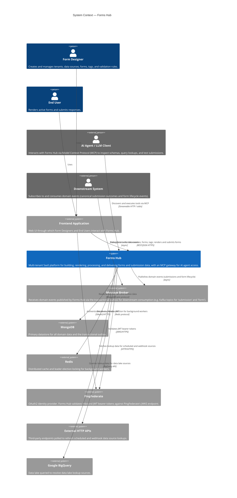

### 3.2 External Interfaces

| External System                | Direction | Protocol                                  | Initiator       | Purpose                                                                                                                                                                                                                   | Status              |
| ------------------------------ | --------- | ----------------------------------------- | --------------- | ------------------------------------------------------------------------------------------------------------------------------------------------------------------------------------------------------------------------- | ------------------- |
| **Frontend Application**       | Inbound   | REST/JSON over HTTPS                      | Frontend        | Form Designers and End Users interact with both services through a generic web UI.                                                                                                                                        | Active              |
| **AI Agent / MCP Client**      | Inbound   | MCP over Streamable HTTP (`/mcp`) or stdio | AI Client       | AI assistants (Cursor, Claude Desktop, OpenCode) discover available tools (`tools/list`) and invoke them (`tools/call`) to inspect form schemas, validate submissions, and retrieve lookups under policy guardrails.     | Active              |
| **MongoDB**                    | Outbound  | MongoDB wire protocol                     | Forms & Tenants | Primary datastore. Tenants Service stores tenant and data source records; Forms Service stores forms, form versions, submissions, tags, tag versions, and transactional outbox events.                                  | Active              |
| **Redis**                      | Outbound  | Redis protocol                            | Forms & Tenants | The Tenants Service and the Forms Service submissions worker use Redis-backed distributed locking (`SetNX` + Lua scripts) for leader election. The Forms Service outbox relay worker does not use leader election — correctness is enforced at the database layer via an atomic claim lease. | Active              |
| **PingFederate**               | Outbound  | JWKS over HTTPS                           | Forms & Tenants | Both services validate inbound JWT bearer tokens by fetching signing keys from PingFederate's JWKS URI. Audience, issuer, expiry, and issued-at claims are verified.                                                      | Active              |
| **External HTTP APIs**         | Outbound  | HTTP/HTTPS                                | Tenants Service | The Tenants Service calls arbitrary third-party HTTP endpoints to fetch lookup key-value pairs for `scheduled` and `webhook` data sources. Supports `GET`, `POST`, `PUT`, and `PATCH` with configurable headers and body. | Active              |
| **Google BigQuery**            | Outbound  | BigQuery API                              | Tenants Service | The Tenants Service queries a configured data lake to resolve lookup data for `data-lake` data sources, using configurable catalog, schema, query, and field mappings.                                                    | Planned (stub only) |
| **Message Broker**             | Outbound  | Async messaging (e.g. Kafka)              | Forms Service   | Forms Service publishes domain events via the transactional outbox relay: submission outcomes (`accepted`, `rejected`) to the `submission` topic, and form lifecycle transitions (`published`, `retired`) to the `form` topic. Events are keyed by aggregate ID with actions specified via an `eventType` header. | Active              |

## 4. Solution Strategy

### 4.1 Architecture Style

Forms Hub is built as a microservice-based system comprising two independently deployable domain services — the **Tenants Service** and the **Forms Service** — alongside an edge protocol adapter, the **MCP Gateway Service**. Each domain service owns its own distinct domain model and data storage, sharing a deliberate, minimal integration surface: the Forms Service depends on the Tenants Service to resolve data sources configured by tenants to provide dynamic lookup data for form fields.

The **MCP Gateway** acts as an edge adapter that bridges LLM agents and AI assistants to Forms Hub via the Model Context Protocol (MCP). It is a stateless service that owns no persistent datastore; instead, it dynamically ingests OpenAPI specifications from the domain services at startup, synthesizes strongly typed MCP tools, enforces least-privilege execution policies, and proxies tool invocations over HTTP.

Within each domain service, a **Ports and Adapters (Hexagonal)** architecture style is applied. The domain and application logic is fully isolated from infrastructure concerns. Ports interfaces in `core/ports/` define the contracts; adapter implementations in `adapters/` fulfill them. This boundary means HTTP, MongoDB, Redis, and inter-service communication concerns can be swapped out or tested independently of domain logic. In-memory adapters for every infrastructure concern support local development and testing without external dependencies. Both domain services also share a common `pkg/` library providing the generic background worker, auth middleware, validation utilities, and the strategy registry — keeping shared infrastructure consistent without coupling service domain models.


_Figure 4.1 — Ports & Adapters (Hexagonal) Architecture pattern. Each Forms Hub service follows this structure: driving adapters (REST handlers) on the left, domain and application services at the centre, and driven adapters (MongoDB, Redis, Tenants Service client) on the right._

### 4.2 Technology Decisions

| Technology                               | Decision                  | Rationale                                                                                                                                                                                |
| ---------------------------------------- | ------------------------- | ---------------------------------------------------------------------------------------------------------------------------------------------------------------------------------------- |
| Go                                       | Implementation language   | Statically typed, high concurrency, fast startup, and a small runtime footprint suited for independently deployable services. See [ADR-010](adr/010-go-over-java.md).                    |
| MongoDB                                  | Database                  | The deeply nested, polymorphic form definition hierarchy — pages, sections, fields, and per-type attributes — maps naturally to documents without requiring a complex relational schema. |
| Message Broker (e.g. Kafka)              | Domain event delivery     | Decouples submission outcomes and form lifecycle events from downstream consumption; the outbox relay publishes domain events for asynchronous consumption. The concrete adapter uses `segmentio/kafka-go`, with an in-memory publisher for local development and testing. Events are routed to topics by `AggregateType` (`submission`, `form`) with action discrimination in an `eventType` header, keyed by `AggregateID`. |
| Redis                                    | Distributed lock          | Provides distributed leader election for background workers in both services without an additional coordination service.                                                                 |
| chi                                      | HTTP router               | Lightweight and idiomatic Go; composable middleware chain supports cross-cutting concerns (auth, tenant extraction, idempotency, correlation ID) without framework lock-in.              |
| `expr-lang/expr`                         | Rule evaluation           | Provides safe, sandboxed evaluation of runtime rule expressions (visibility, required, read-only) without the risks of `eval`-style execution. Supports multi-source evaluation contexts (`field`, `user_claim`) using bracket notation (`source["key"]`) to handle arbitrary identifiers safely. |
| UUID v7                                  | Entity identifiers        | Time-ordered UUIDs provide natural chronological sort order in MongoDB without a separate sequence or auto-increment mechanism.                                                          |
| PingFederate                             | Identity provider         | Enterprise OAuth2/JWKS integration; JWT validation is implemented and ready to activate when authentication is enforced.                                                                 |
| `github.com/modelcontextprotocol/go-sdk` | MCP server implementation | Official Go SDK implementing the Model Context Protocol specification; provides server abstraction, Streamable HTTP (`NewStreamableHTTPHandler`), stdio transports, and tool dispatching.     |
| `github.com/getkin/kin-openapi`          | OpenAPI spec ingestion    | Parses OpenAPI 2.0 (Swagger) and 3.0 specifications, converts v2 specs to v3 (`openapi2conv`), and extracts JSON schemas to dynamically synthesize MCP tools from backend endpoints.   |

### 4.3 Key Design Decisions

- **Asynchronous submission processing** — `POST /submissions` returns 202 immediately; validation and canonical mapping run in a background worker. This decouples intake throughput from validation latency and enables retries without client involvement. Failed jobs are retried with exponential backoff up to a configurable limit; each attempt is recorded as an audit trail on the submission. Terminal outcomes (`accepted` and `rejected`) emit domain events to the outbox collection.
- **Strategy pattern for data sources** — Four lookup strategies (static, scheduled, webhook, data lake) share a common interface and are resolved at runtime via a registry. New source types can be added without modifying existing resolution logic.
- **Strategy pattern for element validation** — Each element type (text, number, select, checkbox, date) has its own validator resolved at runtime. Validation logic is isolated per type and independently testable.
- **Generic distributed worker** — `DistributedWorker[J Job]` is fully generic and reused by both services for completely different job types (data source refresh and submission processing). Redis-backed leader election ensures only one replica processes jobs at a time across horizontal scale.
- **In-memory adapters for all infrastructure** — Every repository, cache, and elector has an in-memory implementation. No external dependencies are required for local development or unit testing.
- **Explicit inter-service boundary** — The Forms Service holds a `DataSourceRef` on certain elements and calls the Tenants Service at submission time to validate that the submitted value is a member of the current valid lookup set. The Frontend also calls the Tenants Service independently at render time to populate the element options. Outside of this integration point the services share no runtime state, simplifying failure isolation and independent deployment.
- **Multi-source operands for rule expressions** — Rule expressions support multi-source evaluation operands via `RuleExprSource` (`field` and `user_claim`). Inbound HTTP requests capture ambient user context (e.g. JWT claims) into a typed `EvaluationContext` upon submission creation and normalization. At processing time, submitted element values are merged under the `field` source type. `ExprRuleEvaluator` compiles expressions using bracket syntax (`field["annualIncome"] > 50000 && user_claim["department"] == "Underwriting"`), allowing rules to evaluate against both submitted values and caller attributes without mutating the form definition schema.
- **Static values in canonical tag mappings** — `ElementTagMapping` supports static values (`hasStaticValue`, `staticValue`). During normalization, static values take precedence over submitted element values. This allows form designers to assign constant canonical facts or inject fixed taxonomy attributes downstream without requiring dedicated form inputs.
- **Deterministic collection indexing for heterogeneous tags** — When multiple form elements map to a repeated collection tag (`[*]`) without explicit submission collection indices, a dedicated `collectionIndexer` dynamically assigns sequential indices per element ID within each collection root. This ensures heterogeneous elements correctly project into normalized array facts.
- **Multi-value element resolution** — `Submission.GetValues(id ElementID)` allows elements to carry multiple submitted values (e.g. repeated collection rows). The resolver unpacks all values so each is independently validated against element constraints prior to normalization.
- **Claim-based outbox relay** — When an aggregate state transition occurs — such as a submission reaching `accepted` or `rejected`, or a form version transitioning `published` or `retired` — a domain event is written to a dedicated `outbox` collection transactionally with the aggregate update. On each tick, the Outbox Relay Worker calls `OutboxRepository.Claim` to atomically transition a batch of eligible events — those with status `pending`, `error`, or `processing` with an expired lease — to `processing` and stamp a `locked_until` timestamp. All replicas run the worker concurrently; correctness is enforced entirely by the atomic claim at the database layer rather than by leader election. Stale leases (e.g. from a crashed replica) expire automatically and are reclaimed on the next tick. The worker uses `PeriodicWorker[J Job]` — a tick-driven worker with no leader election — rather than `DistributedWorker[J Job]`. See ADR-009.
- **Processor layer extracted from application services** — The submission processing pipeline (rule resolution, field validation, canonical tag normalization) is extracted from `SubmissionJobsAPI` into a dedicated `core/processors/` package that implements the `SubmissionProcessor` port. This makes the pipeline independently composable: the Submissions Worker invokes it asynchronously with persistence, while `POST /submissions/normalize` invokes it synchronously without persisting anything. New pipeline concerns can be added or tested in isolation without touching the application service or worker layers.
- **Dynamic OpenAPI-to-MCP tool synthesis** — Rather than manually declaring static tool definitions that drift from API implementations, the MCP Gateway dynamically loads OpenAPI 2.0/3.0 specs from target domain services at startup. The spec loader converts v2 schemas to v3, extracts operations, and translates path parameters, query parameters, and request body schemas into typed JSON Schema input objects (`path`, `query`, `body`).
- **Least-privilege policy engine for agent operations** — The MCP Gateway evaluates tool access against a configurable policy per target using a least-privilege algorithm: (1) Explicit deny rules take precedence, (2) If allow rules are empty, default-allow applies to non-denied endpoints, (3) If allow rules are populated, default-deny applies. Rules support HTTP methods and path globs (e.g. `DELETE /**`, `POST /**/retire`), protecting backend services from destructive or unauthorized actions by AI agents.
- **Pre-configured authentication & tenant encapsulation for AI tools** — The MCP Gateway encapsulates upstream credentials (bearer tokens) and tenant context (`X-Tenant-ID`) directly within target configurations. When executing tools, `HTTPDispatcher` injects these headers transparently into proxied requests, preventing AI agents from needing direct access to sensitive credentials or tenant management headers.

## 5. Building Block View

### 5.1 Whitebox System View

Forms Hub is decomposed into two independently deployable domain services — **Tenants Service** and **Forms Service** — alongside an edge protocol adapter, the **MCP Gateway Service**, plus a shared **`pkg/` library** providing common infrastructure. This functional decomposition reflects that tenant/data-source configuration, form/submission processing, and agentic tool exposition are separate, independently evolvable concerns with no shared domain state.

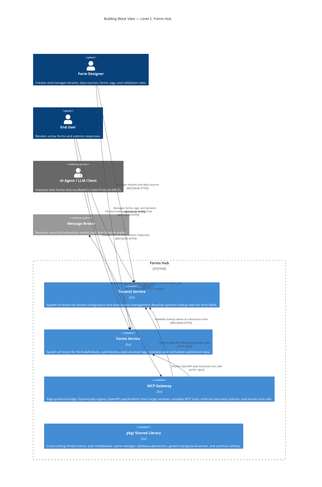

| Building Block            | Responsibility                                                                                                                                                                                                                                   | Source                      |
| ------------------------- | ------------------------------------------------------------------------------------------------------------------------------------------------------------------------------------------------------------------------------------------------ | --------------------------- |
| **Tenants Service**       | System of record for tenant configuration and data source management. Provides CRUD for tenants and data sources, and resolves dynamic lookup key-value pairs via four configurable strategies (`static`, `scheduled`, `webhook`, `data-lake`).  | `backend/services/tenants/` |
| **Forms Service**         | System of record for form definitions, versioned schemas, submissions, and canonical tags. Manages the full form design and submission processing pipeline, including async validation and canonical data normalization.                         | `backend/services/forms/`   |
| **MCP Gateway**           | Edge protocol bridge exposing Forms Hub APIs to LLM agents and AI assistants via Model Context Protocol (MCP). Ingests OpenAPI 2.0/3.0 specs dynamically, compiles tools with typed JSON schemas, evaluates allow/deny execution policies, and proxies tool invocations over HTTP with injected credentials and tenant context. | `backend/services/mcp-gateway/` |
| **`pkg/` Shared Library** | Cross-cutting infrastructure shared by both services: JWT auth middleware, cache abstraction, MongoDB database abstraction, generic background worker with leader election, HTTP utilities, and the strategy registry. Contains no domain logic. | `backend/pkg/`              |

#### 5.1.1 Blackbox: Tenants Service

The Tenants Service owns all tenant and data source configuration. It exposes a REST API for managing tenants and data sources, resolves lookup key-value pairs on demand via a runtime strategy registry, and runs a background worker that periodically refreshes expired `scheduled` data source caches from their configured HTTP endpoints.

| Interface                                  | Direction | Description                                                    |
| ------------------------------------------ | --------- | -------------------------------------------------------------- |
| `GET/POST/PUT/DELETE /api/v1/tenants`      | Inbound   | CRUD for tenant records                                        |
| `GET/POST/PUT/DELETE /api/v1/data-sources` | Inbound   | CRUD for data sources scoped to a tenant                       |
| `GET /api/v1/data-sources/{id}/look-ups`   | Inbound   | Resolves lookup key-value pairs for a given data source        |
| MongoDB                                    | Outbound  | Persists tenant and data source records                        |
| Redis                                      | Outbound  | Leader election for the data source refresh worker             |
| External HTTP APIs                         | Outbound  | Fetches lookup data for `scheduled` and `webhook` data sources |
| Google BigQuery                            | Outbound  | Queries lookup data for `data-lake` data sources (planned)     |

#### 5.1.2 Blackbox: Forms Service

The Forms Service owns all form definitions, versioned schemas, submissions, and canonical tags. It exposes a REST API for form design and submission intake, and runs two background workers: a submissions worker that validates and normalizes pending submissions, and an outbox relay worker that claims batches of eligible outbox events under a distributed lease and publishes each as a domain event to the message broker.

| Interface                                                   | Direction | Description                                                                                                                     |
| ----------------------------------------------------------- | --------- | ------------------------------------------------------------------------------------------------------------------------------- |
| `GET/POST/PUT/DELETE /api/v1/forms`                         | Inbound   | CRUD for forms and their versioned schemas                                                                                      |
| `GET/POST /api/v1/submissions`                              | Inbound   | Submission intake (`202 Accepted`) and listing                                                                                  |
| `POST /api/v1/submissions/normalize`                        | Inbound   | Synchronously validates and normalizes a submission against a form version; returns a canonical fact map. No data is persisted. |
| `POST /api/v1/submissions/{submissionId}/replay`            | Inbound   | Resets a terminal submission to `pending` for reprocessing; returns `202 Accepted`                                              |
| `GET /api/v1/submissions/by-reference/{referenceId}`        | Inbound   | Retrieves a submission by its external reference ID                                                                             |
| `GET /api/v1/submissions/by-reference/{referenceId}/facts`  | Inbound   | Returns the canonical fact map (keyed by tag path) for an `accepted` submission; returns `400` if the submission is not `accepted` |
| `GET /api/v1/submissions/by-reference/{referenceId}/status` | Inbound   | Returns the current status of a submission by reference ID                                                                      |
| `GET/POST/PUT/DELETE /api/v1/tags`                          | Inbound   | CRUD for canonical tags and their versions                                                                                      |
| Tenants Service                                             | Outbound  | Validates submitted lookup values against the live data source at processing time                                               |
| MongoDB                                                     | Outbound  | Persists forms, versions, submissions, tags, tag versions, and transactional outbox events                                       |
| Redis                                                       | Outbound  | Leader election for the submission processing worker only; the outbox relay worker requires no leader election                                                                                                                                                                                   |
| Message Broker                                              | Outbound  | The Outbox Relay Worker claims batches of eligible events from the `outbox` collection via an atomic lease and publishes each as a domain event (submission outcomes to topic `submission`, form lifecycle transitions to topic `form`) |

#### 5.1.3 Blackbox: MCP Gateway

The MCP Gateway provides an AI-native interface to Forms Hub. It exposes a Streamable HTTP handler (`/mcp`) and stdio transport, ingests OpenAPI specifications from backend services at startup, compiles allowed endpoints into typed MCP tools, and dispatches tool execution requests to backend targets with configured tenant and authentication headers.

| Interface                                  | Direction | Description                                                                                                                     |
| ------------------------------------------ | --------- | ------------------------------------------------------------------------------------------------------------------------------- |
| `POST /mcp` (Streamable HTTP) or `stdio`   | Inbound   | Model Context Protocol (MCP) interface for tool discovery (`tools/list`) and invocation (`tools/call`) by AI agents.           |
| Forms Service (`http://forms`)             | Outbound  | Fetches OpenAPI specification (`/swagger/doc.json`) at startup and proxies tool HTTP requests at runtime.                       |
| Tenants Service (`http://tenants`)         | Outbound  | Fetches OpenAPI specification (`/swagger/doc.json`) at startup and proxies tool HTTP requests at runtime.                       |

### 5.2 Level 2

#### 5.2.1 Whitebox: Tenants Service

The Tenants Service follows a Ports and Adapters (Hexagonal) structure. REST handlers on the left drive the application through inbound port interfaces; persistence, client, and worker adapters on the right are driven through outbound port interfaces. The domain and application services at the centre have no dependencies on infrastructure.

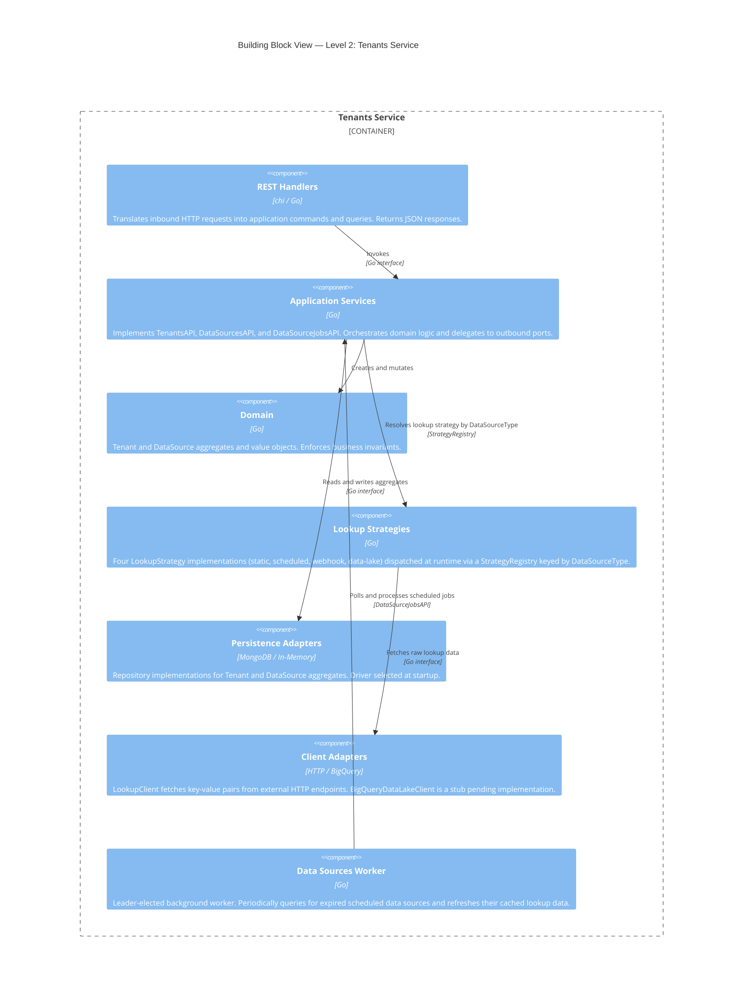

| Building Block           | Responsibility                                                                                                                                                                                                                                       | Source                  |
| ------------------------ | ---------------------------------------------------------------------------------------------------------------------------------------------------------------------------------------------------------------------------------------------------- | ----------------------- |
| **REST Handlers**        | Translates HTTP requests and responses to and from application commands and queries. Applies request validation and maps errors to HTTP status codes.                                                                                                | `adapters/rest/`        |
| **Application Services** | Implements `TenantsAPI`, `DataSourcesAPI`, and `DataSourceJobsAPI`. Orchestrates domain construction, persistence, and strategy dispatch. Enforces tenant ownership on all operations.                                                               | `core/services/`        |
| **Domain**               | `Tenant` and `DataSource` aggregates with their value objects (`Lookup`, `DataSourceAttributes`). Enforces invariants and owns all state transitions.                                                                                                | `core/domain/`          |
| **Lookup Strategies**    | Four `LookupStrategy` implementations resolved at runtime by `DataSourceType`: `static` returns inline data; `scheduled` returns the pre-fetched cache; `webhook` makes a live HTTP call; `data-lake` queries BigQuery (stub).                       | `core/strategies/`      |
| **Persistence Adapters** | MongoDB-backed and in-memory repository implementations for `Tenant` and `DataSource` aggregates. Driver is selected at startup via configuration.                                                                                                   | `adapters/persistence/` |
| **Client Adapters**      | `LookupClient` fetches raw key-value rows from external HTTP endpoints for `scheduled` and `webhook` sources. `BigQueryDataLakeClient` is a stub pending implementation.                                                                             | `adapters/clients/`     |
| **Data Sources Worker**  | Leader-elected background worker. On each tick, queries for `scheduled` data sources with an expired cache and delegates refresh to `DataSourceJobsAPI.Process`. Uses Redis-backed leader election to ensure a single active worker across replicas. | `adapters/workers/`     |

#### 5.2.2 Whitebox: Forms Service

The Forms Service follows the same Ports and Adapters structure as the Tenants Service, with two additional driven components: a Rule Evaluator that assesses visibility and required rules at submission time, and a richer set of Element Validator Strategies — one per element type.

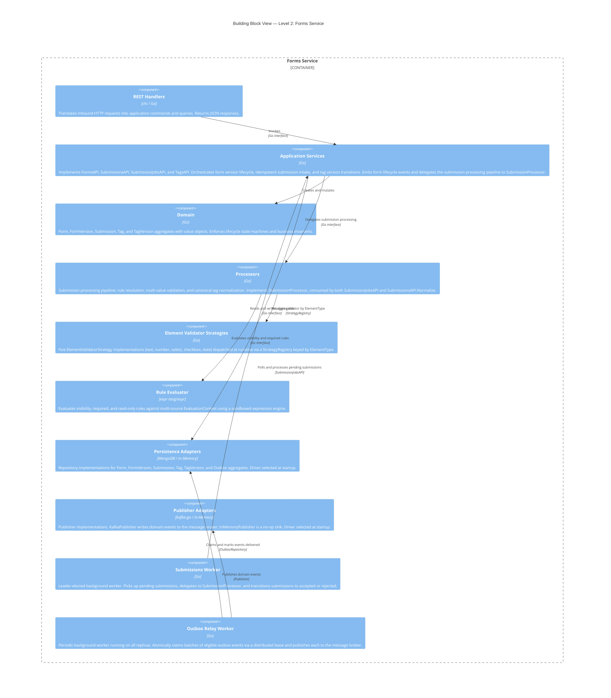

| Building Block                 | Responsibility                                                                                                                                                                                                                                                                                                                                     | Source                  |
| ------------------------------ | -------------------------------------------------------------------------------------------------------------------------------------------------------------------------------------------------------------------------------------------------------------------------------------------------------------------------------------------------- | ----------------------- |
| **REST Handlers**              | Translates HTTP requests and responses to and from application commands and queries. Captures ambient request context (e.g. JWT claims) into `EvaluationContext` and applies idempotency enforcement on submission intake.                                                                                                                        | `adapters/rest/`        |
| **Application Services**       | Implements `FormsAPI`, `SubmissionsAPI`, `SubmissionJobsAPI`, and `TagsAPI`. Orchestrates form version lifecycle, idempotent submission intake, and tag version transitions. Emits form version lifecycle events (`form:published`, `form:retired`) to the outbox. Delegates the submission processing pipeline (rule resolution, validation, normalization) to `SubmissionProcessor`. | `core/services/`        |
| **Domain**                     | `Form`, `FormVersion`, `Submission`, `Tag`, and `TagVersion` aggregates with their value objects (`Page`, `Section`, `Element`, `Rule`, `ElementTagMapping`). Owns all lifecycle state machines (`draft → active → retired`, `draft → active → deprecated → retired`). Both `FormVersion` and `Submission` aggregates embed `withEvents` to record outbox domain events.     | `core/domain/`          |
| **Processors**                 | Implements `SubmissionProcessor`. Composes three steps: `submissionResolver` (initializes `EvaluationContext` with ambient caller context, unpacks repeated values via `s.GetValues()`, merges submitted field values under `field`, and evaluates `visible`/`required` rules to produce a resolved element list), `submissionValidator` (validates each resolved element value via `ElementValidatorRegistry`), and `submissionNormalizer` (resolves winning tag versions, assigns collection indices via `collectionIndexer`, resolves static values via `pickValue`, and produces `CanonicalFact` entries). Consumed by both `SubmissionJobsAPI` (async, with persistence) and `SubmissionsAPI.Normalize` (synchronous, stateless). | `core/processors/`      |
| **Element Validator Strategies** | Five `ElementValidatorStrategy` implementations resolved at runtime by `ElementType`: `text` (string constraints), `number` (numeric bounds), `select`, `checkbox`, and `date` (partial; constraints pending).                                                                                                                                         | `core/strategies/`      |
| **Rule Evaluator**             | `ExprRuleEvaluator` compiles rule expressions into type-safe boolean programs using `expr-lang/expr` and evaluates them against `domain.EvaluationContext` (multi-source map: `field` values and ambient `user_claim` attributes) using bracket notation syntax.                                                                                   | `adapters/evaluators/`  |
| **Persistence Adapters**       | MongoDB-backed and in-memory repository implementations for all aggregates. Driver is selected at startup via configuration.                                                                                                                                                                                                                       | `adapters/persistence/` |
| **Publisher Adapters**         | Implement the `Publisher` port. `KafkaPublisher` writes each domain event to the message broker (topic = event's `AggregateType` e.g. `submission` or `form`, key = `AggregateID`, `eventType` header); `InMemoryPublisher` is a no-op sink for local development and testing. Driver is selected at startup via configuration.                 | `adapters/publishers/`  |
| **Submissions Worker**         | Leader-elected background worker. On each tick, fetches pending submissions and delegates each to `SubmissionProcessor`. Transitions the submission to `accepted` or `rejected` based on the result, emitting domain events to the outbox for both terminal outcomes, and persists the outcome. Retries with exponential backoff; non-retryable errors (validation failures, missing strategy) reject immediately. | `adapters/workers/`     |
| **Outbox Relay Worker**        | `PeriodicWorker[J Job]` running on all replicas concurrently with no leader election. On each tick, calls `OutboxRepository.Claim` to atomically acquire a batch (default: 10) of eligible outbox events under a 5-minute distributed lease, then publishes each as a domain event to the message broker. Mutual exclusion is enforced at the document level by the claim lease. On publish failure, marks the event as `error` and clears the lease; the event is reclaimed on the next tick subject to `retryLimit`. | `adapters/workers/`     |

#### 5.2.3 Whitebox: MCP Gateway

The MCP Gateway bridges AI agents and LLM clients to Forms Hub REST APIs. It is structured around an MCP server core driving an in-memory tool registry populated at startup by an OpenAPI compiler and policy engine, and driven at runtime by an HTTP dispatcher that proxies tool invocations to target services.

```mermaid
C4Component
  title Building Block View — Level 2: MCP Gateway

  Container_Boundary(mcpGateway, "MCP Gateway") {
    Component(mcpServer, "MCP Server", "modelcontextprotocol/go-sdk", "Manages MCP protocol lifecycle, Streamable HTTP (via chi) and stdio transports, and tool execution handlers.")
    Component(targetLoader, "Target Loader", "Go", "Loads target configurations and fetches OpenAPI specifications from URLs or local paths.")
    Component(specParsers, "Spec Parsers", "kin-openapi", "Parses OpenAPI 2.0 (Swagger) and 3.0 specs. Converts v2 documents to v3 using openapi2conv.")
    Component(policyEngine, "Policy Engine", "Go", "Applies least-privilege allow/deny rules with method and path glob matching to filter operations.")
    Component(toolCompiler, "Tool Compiler", "Go", "Extracts allowed operations and synthesizes strongly typed MCP tools with JSON Schema input structures.")
    Component(toolRegistry, "Tool Registry", "Go", "In-memory map storing compiled tools for fast runtime dispatch.")
    Component(httpDispatcher, "HTTP Dispatcher", "Go / http.Client", "Substitutes path parameters, encodes query strings, serializes JSON bodies, injects configured target headers, and executes upstream HTTP calls.")
  }

  Rel(mcpServer, toolRegistry, "Queries compiled tools", "Go map")
  Rel(mcpServer, httpDispatcher, "Dispatches tool call execution", "Dispatcher interface")
  Rel(targetLoader, specParsers, "Dispatches spec parsing by version", "StrategyRegistry")
  Rel(toolCompiler, policyEngine, "Filters operations via policy", "IsAllowed(method, path)")
  Rel(toolCompiler, toolRegistry, "Registers compiled tools", "Register()")
  Rel(httpDispatcher, formsService, "Proxies requests", "HTTP / REST")
  Rel(httpDispatcher, tenantsService, "Proxies requests", "HTTP / REST")
```

| Building Block       | Responsibility                                                                                                                                                                                                                                                                                         | Source                                                    |
| -------------------- | ------------------------------------------------------------------------------------------------------------------------------------------------------------------------------------------------------------------------------------------------------------------------------------------------------ | --------------------------------------------------------- |
| **MCP Server**       | Encapsulates the `mcp.Server` instance. Supports Streamable HTTP (`/mcp` endpoint mounted on `chi` router) and `stdio` transports. Handles incoming `CallToolRequest`, unmarshals `ToolArgs`, and delegates to `Dispatcher`.                                                                           | `internal/mcp/server.go`                                  |
| **Target Loader**    | Reads target configurations from `settings.json`. Fetches OpenAPI specs from local files or remote HTTP URLs with configurable timeouts and custom headers. Dispatches to version-specific parsers via `StrategyRegistry`.                                                                          | `internal/spec/loaders.go`, `internal/spec/target_config.go` |
| **Spec Parsers**     | Parses OpenAPI 2.0 (Swagger) specs using `kin-openapi/openapi2` and converts them to OpenAPI 3.0 using `openapi2conv`. Parses OpenAPI 3.0 specs natively using `kin-openapi/openapi3` and validates them.                                                                                            | `internal/spec/parsers.go`                                |
| **Policy Engine**    | Evaluates candidate operations against configured `allow` and `deny` rules using the Least Privileged Algorithm. Supports HTTP methods and glob path matching (`/*`, `/**`). Catch-all and specific deny rules prevent destructive actions (e.g. `DELETE /**`, `POST /**/retire`).                      | `internal/spec/policy.go`                                 |
| **Tool Compiler**    | Iterates spec paths and operations, evaluates policy, resolves schema properties, and compiles operations into `CompiledTool` objects with structured `path`, `query`, and `body` input schemas. Formats unique tool names (`{target}__{method}_{path}`).                                            | `internal/tools/tools.go`, `compiled_tool.go`, `input_schema.go` |
| **Tool Registry**    | In-memory `Registry` (map) providing registration and O(1) retrieval of `CompiledTool` definitions by tool name.                                                                                                                                                                                       | `internal/tools/registry.go`                              |
| **HTTP Dispatcher**  | Implements the `Dispatcher` interface. Interpolates `{path}` variables, appends query parameters, marshals JSON body payloads, injects target headers (`Authorization: Bearer ...`, `X-Tenant-ID`), and executes upstream requests. Maps HTTP error codes to tool execution failures.                 | `internal/tools/http_dispatcher.go`, `dispatcher.go`      |

#### 5.2.4 Whitebox: `pkg/` Shared Library

The shared library is a flat set of independent Go modules. Each package addresses a single cross-cutting concern and has no dependencies on other `pkg/` packages or on either service's domain.

| Package                   | Responsibility                                                                                                                                                                                                                                                                                | Source                     |
| ------------------------- | --------------------------------------------------------------------------------------------------------------------------------------------------------------------------------------------------------------------------------------------------------------------------------------------- | -------------------------- |
| **`auth`**                | JWT bearer auth middleware and `Claims` context helpers. `NewMiddleware` iterates a list of `Authenticator` functions and responds 401 if all fail.                                                                                                                                           | `pkg/auth/`                |
| **`auth/authenticators`** | `BearerAuthenticator` extracts and delegates `Authorization: Bearer` tokens. `PingFedTokenValidator` validates JWTs against PingFederate's JWKS endpoint. `PlaceholderTokenValidator` is a no-op used in development.                                                                         | `pkg/auth/authenticators/` |
| **`cache`**               | `CacheManager` abstraction (`Get`, `Set`, `Del`) over Redis and in-memory backends. Also exposes `CacheLocker` primitives (`AcquireLock`, `RenewLock`, `ReleaseLock`) used by the distributed elector.                                                                                        | `pkg/cache/`               |
| **`common`**              | Sentinel errors (`ErrNotFound`, `ErrExists`, `ErrInvalidID`, `ErrUnauthorized`), generic config file loaders, HTTP request/response utilities, chi middleware (`CorrelationID`, `RequestDate`, `Tenant`, `Idempotency`), structured logger, generic `StrategyRegistry`, and struct validator. | `pkg/common/`              |
| **`database`**            | `Database` transaction interface (`BeginTx`, `CommitTx`, `RollbackTx`) over MongoDB and a no-op in-memory implementation. `MongoDBRepository` base struct with shared collection helpers.                                                                                                     | `pkg/database/`            |
| **`worker`**              | `DistributedWorker[J Job]`: ticker-driven, leader-elected loop with a goroutine worker pool and graceful 30-second shutdown. `PeriodicWorker[J Job]`: tick-driven worker with no leader election, runs on all replicas. `WorkerContextHandler` injects `worker_id` into structured log records.                                                                                 | `pkg/worker/`              |
| **`worker/elector`**      | `Elector` interface. `CacheElector` implements distributed leader election via Redis `SetNX` + Lua scripts with configurable TTL and renewal interval. `InMemoryElector` is a single-process no-op for local development.                                                                     | `pkg/worker/elector/`      |

### 5.3 Level 3

#### 5.3.1 Whitebox: Lookup Strategy Registry (Tenants Service)

The `DataSourcesAPI.Lookup` method is the single entry point for all lookup resolution. Rather than a switch statement, it delegates to a `StrategyRegistry` — a generic map keyed by `DataSourceType` — which returns the appropriate `LookupStrategy` implementation at runtime. This means new data source types can be added by registering a new strategy without modifying the resolution path.

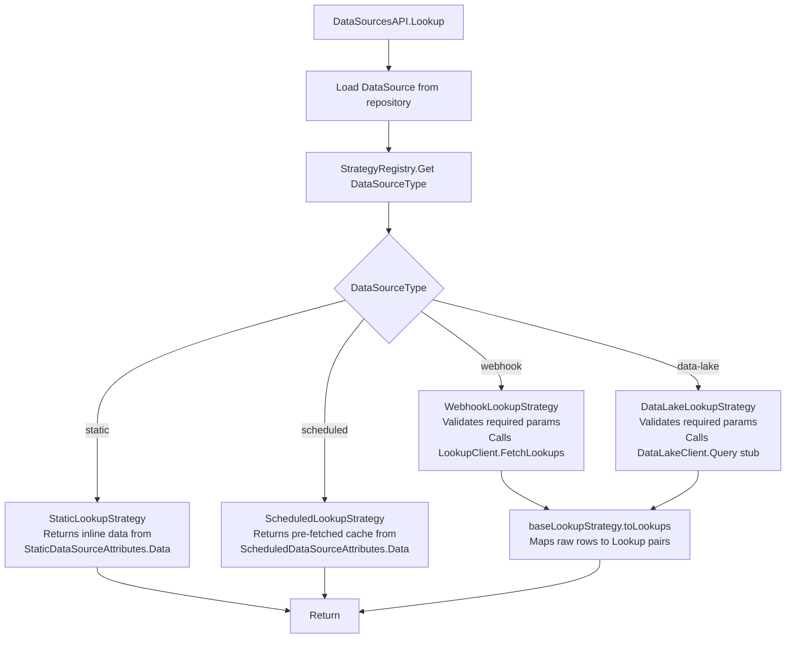

| Building Block                | Responsibility                                                                                                                                                                                                | Source                                    |
| ----------------------------- | ------------------------------------------------------------------------------------------------------------------------------------------------------------------------------------------------------------- | ----------------------------------------- |
| **`LookupStrategy`**          | Port interface. One method: `Lookup(ctx, *DataSource, params) ([]*Lookup, error)`. All four implementations satisfy this contract.                                                                            | `core/ports/secondary.go`                 |
| **`StrategyRegistry`**        | Generic `StrategyRegistry[DataSourceType, LookupStrategy]` map. Returns `ErrStrategyNotFound` on an unregistered key. Populated at startup in `core/strategies/strategies.go`.                                | `pkg/common/stratreg/`                    |
| **`StaticLookupStrategy`**    | Returns `StaticDataSourceAttributes.Data` directly. No external I/O; zero latency.                                                                                                                            | `core/strategies/static_lookup.go`        |
| **`ScheduledLookupStrategy`** | Returns `ScheduledDataSourceAttributes.Data` — the cache populated by the Data Sources Worker. Trades freshness for low latency; staleness is bounded by the configured worker interval.                      | `core/strategies/scheduled_lookup.go`     |
| **`WebhookLookupStrategy`**   | Validates required binding params, then calls `LookupClient.FetchLookups` on every request. Always current but adds per-request HTTP latency.                                                                 | `core/strategies/webhook_lookup.go`       |
| **`DataLakeLookupStrategy`**  | Validates required binding params, then calls `DataLakeClient.Query`. Currently a stub; `BigQueryDataLakeClient` always returns `ErrBigQueryDataLakeNotConfigured`.                                           | `core/strategies/data_lake_lookup.go`     |
| **`baseLookupStrategy`**      | Embedded base providing `toLookups()` (maps raw `[]map[string]any` rows to `[]*Lookup` by configured value/label field names) and `missingRequiredKeys()`. Used by `webhook` and `data-lake` strategies only. | `core/strategies/base_lookup_strategy.go` |

#### 5.3.2 Whitebox: Submission Processing Pipeline (Forms Service)

The submission processing pipeline is the most complex flow in the system. `SubmissionJobsAPI.Process` is called by the Submissions Worker for each pending submission. It fetches the submission, skips it if already terminal, then delegates the core pipeline to `SubmissionProcessor.Process` (`core/processors/`). `SubmissionProcessor` executes three sequential steps: resolve visible/required elements (initializing `EvaluationContext` with ambient caller context, merging submitted element values under `field`, unpacking multi-row values, and evaluating rules across the form hierarchy), validate each resolved element, and normalize to canonical facts (evaluating tag versions, applying static values, and assigning collection indices). On return, `SubmissionJobsAPI` transitions the submission to `accepted` or `rejected`, writes the corresponding domain event (`submission:accepted` or `submission:rejected`) to the `outbox` collection transactionally with the status update, and persists the result. The same `SubmissionProcessor` is also invoked synchronously by `SubmissionsAPI.Normalize` (`POST /submissions/normalize`) without any persistence. See Section 5.3.4 for the Outbox Relay Worker.

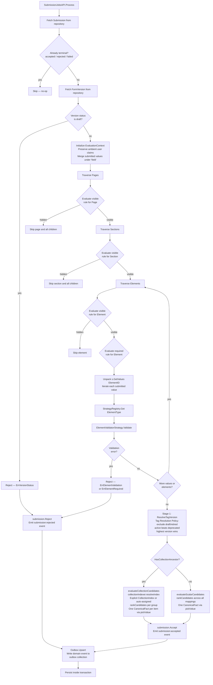

| Building Block                   | Responsibility                                                                                                                                                                                                                                                                                                                                                                                                                                                                                                                                                                                                                                                                                                                                                                                                                                                                                                                                  | Source                                                                   |
| -------------------------------- | ----------------------------------------------------------------------------------------------------------------------------------------------------------------------------------------------------------------------------------------------------------------------------------------------------------------------------------------------------------------------------------------------------------------------------------------------------------------------------------------------------------------------------------------------------------------------------------------------------------------------------------------------------------------------------------------------------------------------------------------------------------------------------------------------------------------------------------------------------------------------------------------------------------------------------------------------- | ------------------------------------------------------------------------ |
| **`SubmissionJobsAPI.Process`**  | Entry point called by the Submissions Worker. Fetches the submission, skips it if already terminal, delegates to `SubmissionProcessor.Process`, then transitions the submission to `accepted` or `rejected`, writes the corresponding outbox event (`submission:accepted` or `submission:rejected`), and persists the result inside a transaction.                                                                                                                                                                                                                                                                                                                                                                                                                                                                                                                                                                                         | `core/services/submission_jobs_service.go`                               |
| **`SubmissionProcessor.Process`** | Composes the three-step pipeline: resolve → validate → normalize. Called by `SubmissionJobsAPI` (async) and `SubmissionsAPI.Normalize` (synchronous). Returns `[]*CanonicalFact` or an error.                                                                                                                                                                                                                                                                                                                                                                                                                                                                                                                                                                                                                                                                                                                                                  | `core/processors/submission_processor.go`                                |
| **`RuleEvaluationContext`**      | Typed alias for `domain.EvaluationContext` (`map[RuleExprSourceType]map[string]any`). Initialized with ambient context (`user_claim`) and merged with submitted field values (`field`) during resolution. Passed to every rule evaluation call.                                                                                                                                                                                                                                                                                                                                                                                                                                                                                                                                                                                                                                                                                                | `core/ports/secondary.go`                                                |
| **`RuleEvaluator`**              | `ExprRuleEvaluator` evaluates `visible` and `required` rules against `EvaluationContext` using bracket notation syntax (`source["key"]`). Returns `bool`. Determines whether a page, section, or element is processed at all.                                                                                                                                                                                                                                                                                                                                                                                                                                                                                                                                                                                                                                                                                                                 | `adapters/evaluators/expr_rule_evaluator.go`                             |
| **`ElementValidatorRegistry`**     | Generic `StrategyRegistry[ElementType, ElementValidatorStrategy]` map. Returns `ErrStrategyNotFound` on an unregistered key — treated as non-retryable.                                                                                                                                                                                                                                                                                                                                                                                                                                                                                                                                                                                                                                                                                                                                                                                             | `pkg/common/stratreg/`                                                   |
| **`ElementValidatorStrategy`**     | One implementation per `ElementType` (`text`, `number`, `select`, `checkbox`, `date`). Validates each submitted value against the element's configured constraints.                                                                                                                                                                                                                                                                                                                                                                                                                                                                                                                                                                                                                                                                                                                                                                           | `core/strategies/`                                                       |
| **Canonical Tag Mapping**        | Two-stage normalization pipeline run after all elements pass validation. **Stage 1 (Tag Version Resolution):** for each `Tag` referenced by the submission's `ElementTagMapping` entries, `domain.ResolveTagVersion` selects the winning `TagVersion` using the Tag Resolution Policy. **Stage 2 (Fact Mapping Priority):** the pipeline dispatches to one of two evaluation paths based on `tag.HasCollectionAncestor()`. For scalar tags, `evaluateScalarCandidates` selects the single highest-priority `ElementTagMapping` winner via `rankCandidates`, extracts the value via `pickValue` (prioritizing `etm.StaticValue` when `etm.HasStaticValue` is `true`), and produces one `CanonicalFact`. For collection tags, `evaluateCollectionCandidates` resolves item indices via `collectionIndexer` (using explicit `CollectionIndex` if present or auto-assigning sequential indices per element ID within the collection root for heterogeneous mappings), groups candidates by index, applies `rankCandidates` within each group, and produces one `CanonicalFact` per collection element via `pickValue`. Each `CanonicalFact` is keyed by tag key rather than form element key. See Section 6.1 for the Tag Resolution Policy Table and Fact Mapping Policy Table. | `core/processors/submission_normalizer.go`, `core/domain/tag_version.go` |
| **`submission.Accept / Reject`** | Domain methods that transition `Submission` status to `accepted` or `rejected` and emit corresponding domain events (`submission:accepted` with facts map, `submission:rejected` with rejection reason). Persisted and written to the outbox inside a database transaction.                                                                                                                                                                                                                                                                                                                                                                                                                                                                                                                                                                                                                                                                  | `core/domain/submission.go`                                              |

**Retry and error classification:**

| Error                                                         | Classification | Outcome                                                                                           |
| ------------------------------------------------------------- | -------------- | ------------------------------------------------------------------------------------------------- |
| `ErrElementValidation`, `ErrElementRequired`, `ErrElementTypeValue` | Non-retryable  | Submission transitions to `rejected` immediately                                                  |
| `ErrVersionStatus` (draft version)                            | Non-retryable  | Submission transitions to `rejected` immediately                                                  |
| `ErrStrategyNotFound`                                         | Non-retryable  | Submission transitions to `failed` immediately                                                    |
| Any other error (network, DB)                                 | Retryable      | Worker retries with exponential backoff up to `retryLimit`; transitions to `failed` on exhaustion |

#### 5.3.3 Whitebox: Generic Distributed Worker (`pkg/worker`)

`DistributedWorker[J Job]` is a fully generic, reusable component shared by both services. It manages the full leader election state machine, job fetching, and goroutine pool dispatch — the consuming service only provides a `FetchJobsFn` and a `Job` implementation. The diagram shows the lifecycle from startup through graceful shutdown.

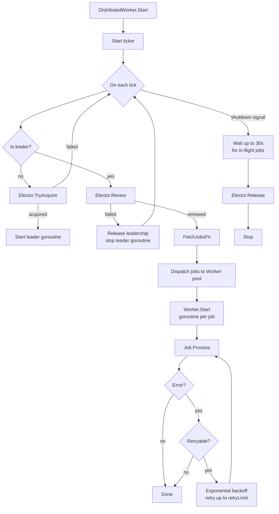

| Building Block                | Responsibility                                                                                                                                                                                                                                           | Source                                   |
| ----------------------------- | -------------------------------------------------------------------------------------------------------------------------------------------------------------------------------------------------------------------------------------------------------- | ---------------------------------------- |
| **`DistributedWorker[J Job]`** | Ticker-driven orchestrator. Manages leader election state, calls `FetchJobsFn` on each tick as leader, and dispatches jobs to the worker pool. Configured entirely via functional options.                                                             | `pkg/worker/distributed_worker.go`       |
| **`Job`**                     | Interface with a single method: `Process(ctx) error`. Implemented per service — `dataSourceJob` in the Tenants Service and `submissionJob` in the Forms Service.                                                                                         | `pkg/worker/worker.go`                   |
| **`Worker[J Job]`**           | Single goroutine that pulls a job from a channel and calls `Job.Process`. Supports an optional per-job timeout and recovers from panics.                                                                                                                 | `pkg/worker/worker.go`                   |
| **`FetchJobsFn[J]`**          | `func(context.Context) ([]J, error)` supplied by the consuming service. Called on each tick by the leader to retrieve the current job set.                                                                                                             | `pkg/worker/distributed_worker.go`       |
| **`Elector`**                 | Interface with `TryAcquire`, `Renew`, and `Release`. Abstracts leader election; two implementations exist.                                                                                                                                               | `pkg/worker/elector/elector.go`          |
| **`CacheElector`**            | Distributed elector backed by Redis `SetNX` + Lua scripts. TTL of 2 minutes; renewed every 1 minute. Keyed per service (`service:tenants:elector`, `service:forms:elector`). Ensures only one replica runs the worker at a time across horizontal scale. | `pkg/worker/elector/cache_elector.go`    |
| **`InMemoryElector`**         | Single-process no-op elector. Always acquires leadership. Used in local development and testing to avoid a Redis dependency.                                                                                                                             | `pkg/worker/elector/inmemory_elector.go` |

#### 5.3.4 Whitebox: Outbox Relay Worker (Forms Service)

When an aggregate emits domain events — e.g. when the Submissions Worker transitions a submission to `accepted` or `rejected`, or when `FormsService` publishes or retires a `FormVersion` — the domain events are written to the `outbox` collection transactionally with the aggregate state update. The Outbox Relay Worker takes over. All replicas run the worker concurrently using `PeriodicWorker[J Job]`, which has no leader election. On each tick, each replica calls `OutboxRepository.Claim` to atomically acquire a batch of eligible events and stamp a `locked_until` lease before any publish attempt. The atomic claim at the database layer ensures each event is processed by exactly one replica; a crashed replica's events are automatically reclaimed once the lease elapses.

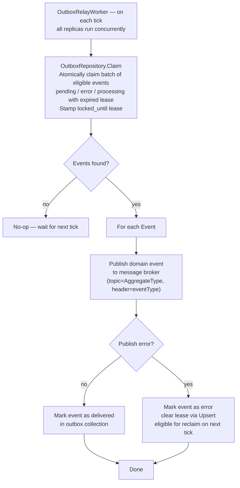

| Building Block              | Responsibility                                                                                                                                                                                                                                                                                                                                                                                                                                                                                                                | Source                                    |
| --------------------------- | ----------------------------------------------------------------------------------------------------------------------------------------------------------------------------------------------------------------------------------------------------------------------------------------------------------------------------------------------------------------------------------------------------------------------------------------------------------------------------------------------------------------------------- | ----------------------------------------- |
| **`OutboxRepository`**      | Secondary port. `Claim` atomically transitions a batch of eligible events to `processing` and stamps a `locked_until` lease, returning only those events. Eligibility: status `pending` or `error`, or status `processing` with `locked_until` in the past. `Upsert` persists the outcome (delivered or failed) and clears the `locked_until` field via `$unset`.                                                                                                                                                     | `core/ports/secondary.go`                 |
| **`Publisher`**             | Secondary port. `Publish` sends domain events to the message broker on the topic matching `event.AggregateType` with an `eventType` header. Called directly by the Outbox Relay Worker per event.                                                                                                                                                                                                                                                                                                                           | `core/ports/secondary.go`                 |
| **`OutboxRelayWorker`**     | `PeriodicWorker[J Job]` running on all replicas concurrently with no leader election; mutual exclusion is delegated entirely to the `Claim` lease. On each tick calls `OutboxRepository.Claim` to atomically acquire a batch (default: 10) of eligible events under a 5-minute lease, calls `Publisher.Publish` for each (publishing submission outcomes to topic `submission` and form lifecycle transitions to topic `form`), and calls `OutboxRepository.Upsert` to record the outcome and clear the lease. On publish failure, marks the event as `error` and clears the lease; the event becomes eligible for reclaim on the next tick subject to `retryLimit`. Bypasses the primary port layer — operates entirely on secondary ports via the `core.Application` struct. | `adapters/workers/outbox_relay_worker.go` |

#### 5.3.5 Whitebox: Dynamic Tool Compilation and Execution Pipeline (MCP Gateway)

The MCP Gateway pipeline operates in two distinct phases: startup compilation (which dynamically converts upstream OpenAPI specifications into typed MCP tools constrained by security policies) and runtime dispatch (which translates MCP tool execution requests into upstream HTTP calls with injected tenant and authorization headers).

```mermaid
flowchart TD
    subgraph Startup [Startup: Tool Compilation]
        A[Load settings.json Targets] --> B[TargetLoader.Load TargetConfig]
        B --> C{Spec Version}
        C -->|2.0| D[parseV2: Unmarshal openapi2 & convert via openapi2conv.ToV3]
        C -->|3.0| E[parseV3: Parse & validate openapi3]
        D --> F[openapi3.T Document]
        E --> F
        F --> G[ExtractTools]
        G --> H[Iterate Paths & Operations]
        H --> I{Policy.IsAllowed\nmethod, path}
        I -->|Denied| J[Skip operation]
        I -->|Allowed| K[compileOperation\nBuild inputSchema for path, query, body]
        K --> L["Format Tool Name:\ntarget__method_path"]
        L --> M[Registry.Register CompiledTool]
    end

    subgraph Runtime [Runtime: Tool Execution]
        N[Incoming CallToolRequest from MCP Client] --> O[readRequestArgs\nUnmarshal into ToolArgs]
        O --> P[Registry.Get tool.Name]
        P --> Q[HTTPDispatcher.Dispatch]
        Q --> R[Interpolate URL path parameters]
        R --> S[Append query parameters]
        S --> T[Marshal JSON body payload]
        T --> U["Inject configured Target Headers\nAuthorization, X-Tenant-ID"]
        U --> V[client.Do HTTP Request]
        V --> W{Status >= 400?}
        W -->|Yes| X[Return CallToolResult IsError=true]
        W -->|No| Y[Return CallToolResult Content=TextContent]
    end
```

| Building Block                | Responsibility                                                                                                                                                                                                                                           | Source                                    |
| ----------------------------- | -------------------------------------------------------------------------------------------------------------------------------------------------------------------------------------------------------------------------------------------------------- | ----------------------------------------- |
| **`TargetLoader.Load`**       | Retrieves specification bytes via local file read (`spec.Path`) or HTTP GET (`spec.URL`) with configured timeouts and headers. Delegates to version parser via `StrategyRegistry`.                                                                      | `internal/spec/loaders.go`                |
| **`parseV2` / `parseV3`**     | Parser strategy functions registered in `StrategyRegistry[string, parserFn]`. `parseV2` handles Swagger 2.0 schemas and upgrades them to OpenAPI 3.0 via `openapi2conv`. `parseV3` loads and validates OpenAPI 3.0 schemas.                             | `internal/spec/parsers.go`                |
| **`PolicyConfig.IsAllowed`**  | Enforces the Least Privileged Algorithm against candidate endpoints. Evaluates `deny` patterns first (immediate rejection on match), permits all non-denied endpoints if `allow` is empty, or enforces default-deny if `allow` is populated. Supports wildcards (`*`, `/*`, `/**`). | `internal/spec/policy.go`                 |
| **`compileOperation`**        | Translates OpenAPI `Parameters` (in path or query) and `RequestBody` (`application/json`) into structured `inputSchema` objects using `inputSchemaBuilder`. Formats names as `<targetName>__<method>_<path>`.                                            | `internal/tools/compiled_tool.go`, `input_schema.go` |
| **`Registry`**                | In-memory map type `map[string]CompiledTool` with `Register`, `Get`, and `All` methods for thread-safe access to compiled tool definitions.                                                                                                              | `internal/tools/registry.go`              |
| **`HTTPDispatcher.Dispatch`** | Executes the compiled tool's HTTP contract: substitutes `{param}` placeholders in the target URL, appends query string arguments, serializes JSON bodies, injects target headers (`Authorization`, `X-Tenant-ID`), and handles upstream response statuses. | `internal/tools/http_dispatcher.go`       |

## 6. Runtime View

### 6.1 Form Submission Flow


A client submits a form by sending `POST /api/v1/submissions` with an `Idempotency-Key` header. The Forms Service captures any ambient caller context (such as authenticated JWT claims) into an `EvaluationContext` under the `user_claim` source type, persists the submission with a status of `pending`, and immediately returns `202 Accepted` with a reference ID — no element validation occurs synchronously. A background worker (leader-elected via Redis) picks up pending submissions, loads the associated form version, and delegates to the submission processing pipeline.

During resolution, the pipeline merges submitted element values into `EvaluationContext[field]`. For multi-value collection inputs, `Submission.GetValues(element.ID)` unpacks all submitted values for that element. The `ExprRuleEvaluator` assesses `visible`, `required`, and `readonly` rules against both `field` and `user_claim` context using bracket notation syntax (`source["key"]`). For `select` elements backed by a `DataSourceRef`, the Forms Service calls the Tenants Service to resolve the current valid lookup set and validate that the submitted value is a member of it. Note that the Frontend also calls the Tenants Service independently at render time to populate dropdown options — the validation call at submission time is a server-side confirmation that the selected value remains valid.

On success, the submission transitions to `accepted`, its canonical facts are stored, and a `submission:accepted` domain event (carrying the full canonical fact map) is written to the `outbox` collection transactionally with the status update. On validation or domain rule failure, the submission transitions to `rejected`, and a `submission:rejected` domain event (carrying the failure reason) is written to the `outbox` collection transactionally. The Outbox Relay Worker — a `PeriodicWorker[J Job]` running on all replicas concurrently with no leader election — calls `OutboxRepository.Claim` on each tick to atomically acquire a batch of eligible outbox events under a short-lived distributed lease and publishes each to the `submission` topic on the message broker with an `eventType` header, introducing a tick-interval delay between aggregate state change and delivery. Events whose lease expires before delivery (e.g. due to a replica crash) are automatically reclaimed on the next tick. Failed attempts due to transient infrastructure errors are retried with exponential backoff up to the configured retry limit before transitioning to `failed`.

A synchronous alternative is available via `POST /api/v1/submissions/normalize`. This endpoint captures ambient claims into `EvaluationContext` and runs the same processing pipeline (rule resolution, multi-value validation, and canonical tag mapping) in-memory against the submitted values and returns the resulting fact map immediately — no submission record is created, no status is persisted, and no outbox event is written. This is useful for previewing canonical output before committing a real submission.


Canonical normalization decouples the submission data from the form's element naming and layout. Each form element carries one or more `ElementTagMapping` entries that associate it with an active tag version. During submission processing, submitted element values are mapped through these tag mappings to produce a normalized output keyed by canonical tag — not by form element key. This means downstream systems consume a consistent data structure regardless of which form version collected the data or how its elements were named.

**Static Tag Values:** An `ElementTagMapping` may configure a static value (`hasStaticValue`, `staticValue`). When present, `pickValue` selects the static value rather than the submitted element value, allowing form designers to inject fixed canonical taxonomy or constants into downstream facts without requiring user input.


When an element maps to multiple tag versions, the winning tag version is selected through a two-phase resolution. First, `draft` and `retired` tag versions are excluded entirely. Among the remaining candidates, `active` tag versions always take precedence over `deprecated` ones. If only `deprecated` tag versions remain, the system selects the one with the highest version number. If no eligible candidate remains after exclusion, `ResolveTagVersion` returns `ErrNoEligibleTagVersion` and the submission transitions to `failed`.


Once the winning tag version has been selected, the system evaluates all `ElementTagMapping` entries associated with that tag version across the form's elements:

- **Scalar Tags:** For tags representing single scalar values (`HasCollectionAncestor() == false`), `evaluateScalarCandidates` ranks all eligible mappings by priority. The highest-priority mapping wins, and its value (static or submitted, via `pickValue`) is emitted as a single `CanonicalFact`.
- **Collection Tags:** For tags representing repeated structures (`HasCollectionAncestor() == true`, indicated by the `[*]` segment in the key path), `evaluateCollectionCandidates` resolves item indices using `collectionIndexer`. If a candidate value carries an explicit `CollectionIndex`, that index is used. If an explicit index is missing (e.g. heterogeneous form elements mapping into different fields of a single collection root), `collectionIndexer` dynamically assigns sequential indices per element ID within that collection root. Candidates are grouped by index, ranked by priority within each group, and mapped via `pickValue` into one `CanonicalFact` per collection element.

If multiple mappings share the same priority, tiebreaker rules ensure deterministic selection.

#### 6.1.1 Example: Requesting a Form-based Catalog Item


This diagram illustrates a concrete example of the submission flow in the context of a service request workflow. The Request Portal and Service Catalog are example external systems outside the Forms Hub boundary — Forms Hub is involved at two points only: serving the form definition when the actor selects a catalog item (step 4), and receiving the completed submission for validation, normalization, and processing at checkout (step 8). The SRI Service shown in the diagram is an example downstream consumer that receives domain events (`submission:accepted` or `submission:rejected`) published by Forms Hub upon completion of submission processing.

### 6.2 Data Source Lookup Resolution


When a client calls `GET /api/v1/data-sources/{id}/look-ups`, the Tenants Service loads the data source from MongoDB and dispatches to the appropriate strategy via a runtime registry keyed by `DataSourceType`. The `static` strategy returns inline lookup data stored directly on the data source record. The `scheduled` strategy returns cached data previously fetched from an external HTTP endpoint by the background refresh worker — trading freshness for low latency. The `webhook` strategy makes a live HTTP call to the configured endpoint on each request, passing any required binding parameters — higher latency but always current. The `data-lake` strategy queries a configured BigQuery dataset using a parameterized query (currently a stub pending implementation). All four strategies return a uniform `[]Lookup` response of `{ value, label }` pairs.

### 6.3 Form Version Lifecycle

Form versions follow a linear, managed lifecycle: `draft → active → retired`. Only `draft` versions can be edited; once published they are immutable. Multiple versions of the same form may be `active` simultaneously, allowing a gradual transition between versions. Lifecycle transitions (`publish` and `retire`) emit domain events to the `outbox` collection transactionally, which the Outbox Relay Worker publishes to the `form` topic on the message broker.

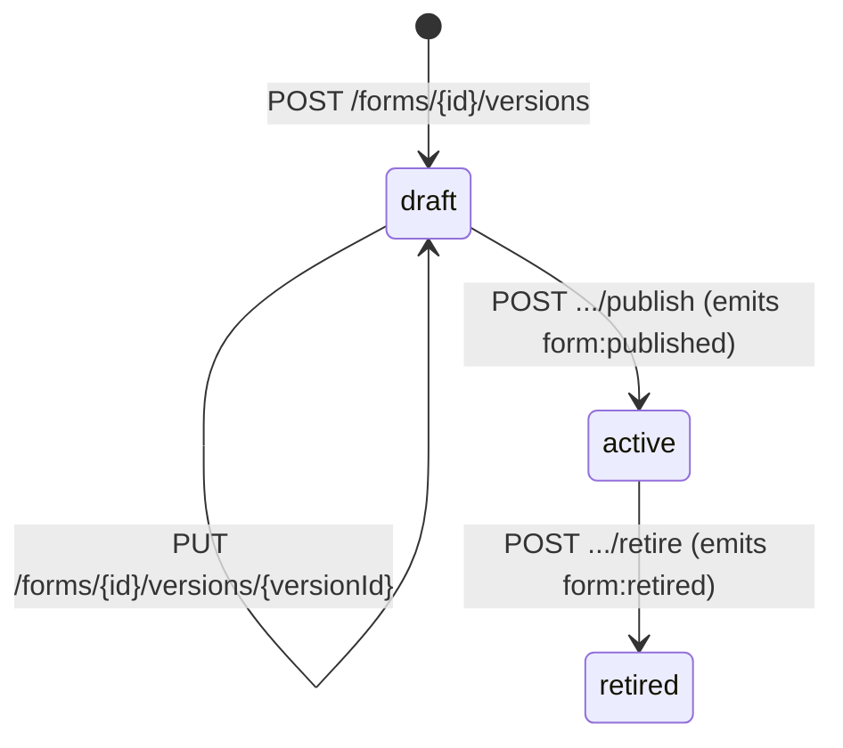

| Transition   | Endpoint                                            | Conditions                                                                                        | Outbox Domain Event |
| ------------ | --------------------------------------------------- | ------------------------------------------------------------------------------------------------- | ------------------- |
| Create draft | `POST /forms/{formId}/versions`                     | Always allowed; auto-increments version number                                                    | None                |
| Update draft | `PUT /forms/{formId}/versions/{versionId}`          | Only allowed while status is `draft`; updates form definition or metadata; locked once published  | None                |
| Publish      | `POST /forms/{formId}/versions/{versionId}/publish` | Transitions `draft → active`; does not affect other active versions                               | `form:published` carrying version, metadata, and publisher identity |
| Retire       | `POST /forms/{formId}/versions/{versionId}/retire`  | Transitions `active → retired`; a form cannot be deleted while it has at least one active version | `form:retired` carrying version and retiree identity |

### 6.4 Tag Version Lifecycle

Tag versions follow a four-stage lifecycle: `draft → active → deprecated → retired`. Unlike form versions, the path to retirement requires passing through `deprecated` first — a tag cannot be retired directly from `active`. This enforces a grace period during which downstream systems can observe the deprecation before the tag is fully retired. At most one `active` version per tag can exist at any given time; publishing a new version atomically deprecates any existing `active` version in the same transaction.

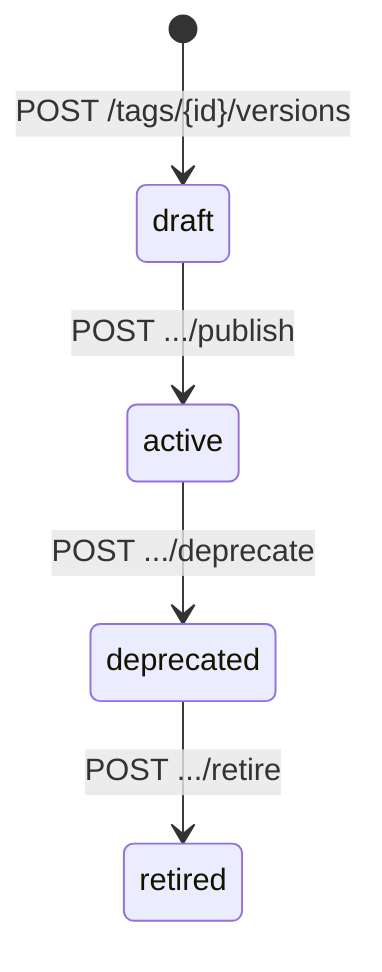

| Transition   | Endpoint                                            | Conditions                                                                                                                           |
| ------------ | --------------------------------------------------- | ------------------------------------------------------------------------------------------------------------------------------------ |
| Create draft | `POST /tags/{tagId}/versions`                       | Always allowed; auto-increments version number                                                                                       |
| Publish      | `POST /tags/{tagId}/versions/{versionId}/publish`   | Transitions `draft → active`; only allowed from `draft`; atomically deprecates any existing `active` version in the same transaction |
| Deprecate    | `POST /tags/{tagId}/versions/{versionId}/deprecate` | Transitions `active → deprecated`; only allowed from `active`                                                                        |
| Retire       | `POST /tags/{tagId}/versions/{versionId}/retire`    | Transitions `deprecated → retired`; only allowed from `deprecated`                                                                   |

### 6.5 MCP Tool Discovery and Execution Flow

The Model Context Protocol (MCP) Gateway enables AI agents (e.g. Cursor, Claude Desktop, OpenCode) to interact with Forms Hub domain services safely. Tool discovery and tool invocation proceed in two runtime phases following initial startup ingestion.

#### 6.5.1 Sequence: Discovery and Invocation

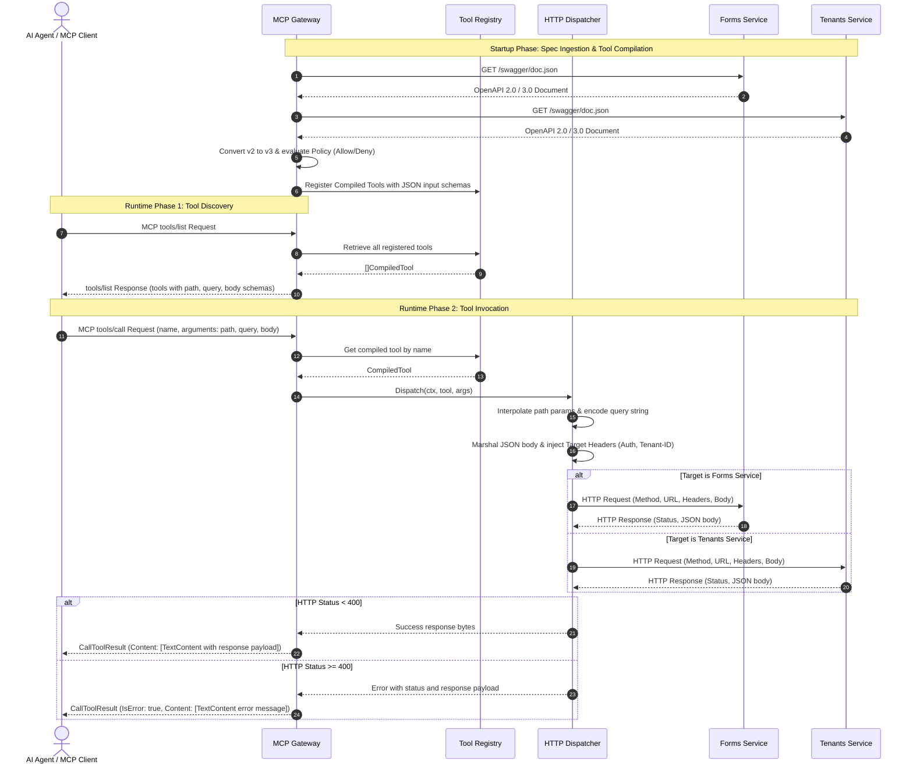

#### 6.5.2 Execution Details

1. **Startup Spec Ingestion & Tool Compilation:** On initialization, the Gateway queries target services (`forms` and `tenants`) for their OpenAPI specifications (`/swagger/doc.json`). Specifications defined in Swagger 2.0 are converted to OpenAPI 3.0 schemas in-memory via `kin-openapi/openapi2conv`.
2. **Policy Filtering:** Each operation is evaluated against the target's configured `PolicyConfig`. Deny rules take precedence (e.g., `DELETE /**`, `POST /**/retire`), followed by allow rules. Operations violating policy are excluded from tool compilation.
3. **Tool Schema Generation:** Allowed operations are compiled into `CompiledTool` records. Path parameters, query parameters, and JSON request bodies are mapped into an `inputSchema` structure with dedicated `path`, `query`, and `body` object properties. Tool names follow the deterministic format `<targetName>__<method>_<path>` (e.g. `forms_api__get_api_v1_forms` or `tenants_api__get_api_v1_data_sources_id_look_ups`).
4. **Tool Discovery:** MCP clients connecting via Streamable HTTP (`POST /mcp`) or `stdio` issue `tools/list` to inspect available actions and their parameter schemas.
5. **Tool Invocation & Header Injection:** When an agent invokes a tool via `tools/call`, the `HTTPDispatcher` unpacks `ToolArgs`, replaces URL path variables (`{param}`), attaches query parameters, serializes request bodies, and injects configured target headers (`Authorization: Bearer <token>`, `X-Tenant-ID: <tenantId>`).
6. **Error Wrapping:** If the upstream target returns a status code `>= 400`, the dispatcher captures the HTTP response and returns a structured `CallToolResult` with `IsError: true`, preventing agent protocol crashes while providing clear upstream diagnostic messages to the LLM.

## 7. Deployment View

Forms Hub is deployed to Wells Fargo's internal OpenShift Container Platform (OCP) via Harness pipelines using Helm charts. The domain services and the MCP Gateway are independently deployable and co-located in the same Kubernetes cluster and namespace. CI is managed through GitHub Actions; CD is managed through Harness.

### 7.1 Environments

| Environment    | Description                                                                                                                                                                                                            |
| -------------- | ---------------------------------------------------------------------------------------------------------------------------------------------------------------------------------------------------------------------- |
| **Local**      | Docker Compose. Runs MongoDB, Redis, Kafka, Tenants Service (port 8081), Forms Service (port 8080), and MCP Gateway (port 8082). In-memory adapters available as an alternative via configuration.                  |
| **Dev**        | Deployed to OCP. First integration environment; used for active development verification.                                                                                                                              |
| **Test**       | Deployed to OCP. Used for automated integration and end-to-end testing.                                                                                                                                                |
| **QA**         | Deployed to OCP. Used for business and acceptance testing prior to production promotion.                                                                                                                               |
| **Production** | Deployed to OCP across multiple Wells Fargo internal data centers.                                                                                                                                                     |

### 7.2 Deployment Architecture

Each service is packaged as a Docker image and deployed as a Kubernetes `Deployment`. Multiple replicas of the domain services may run simultaneously; Redis leader election ensures only one replica runs the Tenants Service background worker and the Forms Service submissions worker at any given time, while the Forms Service outbox relay worker runs concurrently across all replicas using document-level atomic claim leases in MongoDB.

The **MCP Gateway** is deployed as an independent, stateless `Deployment`. It serves Streamable HTTP on `/mcp` (port 80) and proxies tool invocations to upstream services via internal Kubernetes DNS (`http://forms`, `http://tenants`). The gateway requires no datastore, cache, or message broker connectivity.

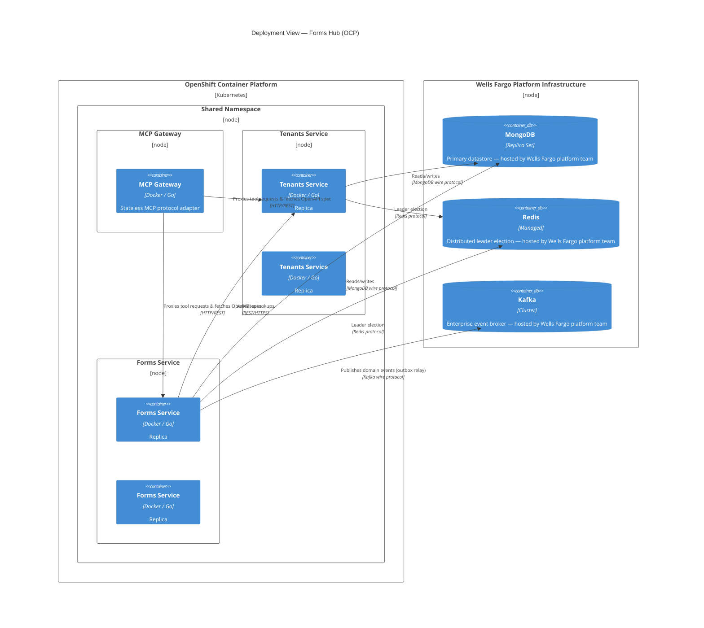

### 7.3 Configuration and Secrets

All runtime configuration is provided via environment variables injected into the Kubernetes cluster from Vault prior to deployment. No secrets are stored in Helm charts or image artifacts.

| Concern                                 | Mechanism                                                                                        |
| --------------------------------------- | ------------------------------------------------------------------------------------------------ |
| Application config                      | Environment variables (`APP_*` prefix)                                                           |
| Secrets (DB credentials, Redis, OAuth2) | Vault → Kubernetes Secrets → environment variables                                               |
| Auth (PingFederate JWKS)                | `APP_SERVER_AUTH_OAUTH2_JWK`, `APP_SERVER_AUTH_OAUTH2_AUDIENCE`, `APP_SERVER_AUTH_OAUTH2_ISSUER` |
| Database driver selection               | `APP_DATABASE_DRIVER` (`mongodb` or `inmemory`)                                                  |
| Cache type selection                    | `APP_CACHE_TYPE` (`redis` or `inmemory`)                                                         |
| Publisher selection                     | `APP_PUBLISHER_TYPE` (`kafka` or `in-memory`); Kafka brokers via `APP_PUBLISHER_KAFKA_ADDR`      |
| MCP Gateway configuration               | `settings.json` (or `--settings` path); defines `logLevel`, `transport` (`http`/`stdio`), `port`, and `targets` |
| MCP Target definitions & security rules | Configured in `settings.json`: target `baseUrl`, `spec` (`url`/`path`), headers (`Authorization`, `X-Tenant-ID`), timeout, and policy `allow`/`deny` lists |

### 7.4 CI/CD Pipeline

| Stage            | Tooling        | Description                                                                                                                            |
| ---------------- | -------------- | -------------------------------------------------------------------------------------------------------------------------------------- |
| Build & Test     | GitHub Actions | Compiles both services, runs unit tests, and produces Docker images on each push.                                                      |
| Image Publishing | GitHub Actions | Pushes versioned Docker images to the Wells Fargo container registry.                                                                  |
| Deployment       | Harness + Helm | Deploys the Helm chart to the target OCP environment. Promotion through dev → test → QA → production is managed via Harness pipelines. |

## 8. Crosscutting Concepts

### 8.1 Domain Model

Forms Hub maintains two independent domain models — one per service — with no shared types between them. The only cross-domain reference is `DataSourceRef`, a value object on the Forms Service domain that holds a `DataSourceID` pointing to a data source owned by the Tenants Service.

#### 8.1.1 Tenants Service Domain


| Entity                      | Description                                                                                                                                                                                                                                                                                                                                                                          |
| --------------------------- | ------------------------------------------------------------------------------------------------------------------------------------------------------------------------------------------------------------------------------------------------------------------------------------------------------------------------------------------------------------------------------------ |
| **`Tenant`**                | Root aggregate. Owns zero or more `DataSource` records. All data sources are deleted atomically within a transaction when their tenant is deleted.                                                                                                                                                                                                                                   |
| **`DataSource`**            | Represents a named lookup source scoped to a tenant. Carries a polymorphic `DataSourceAttributes` interface — one concrete struct per `DataSourceType` (`static`, `scheduled`, `webhook`, `data-lake`).                                                                                                                                                                              |
| **`DataSourceAttributes`**  | Interface with concrete implementations per `DataSourceType`: `StaticDataSourceAttributes` (inline `[]Lookup` data); `ScheduledDataSourceAttributes` (HTTP config + in-document `[]Lookup` cache refreshed by the worker); `WebhookDataSourceAttributes` (HTTP config + required binding keys); `DataLakeDataSourceAttributes` (BigQuery catalog, schema, and query — stub pending). |
| **`DataSourceHTTPRequest`** | Value object embedded by `scheduled` and `webhook` attributes. Configures the URL, HTTP method, headers, and value/label field mappings for external HTTP calls.                                                                                                                                                                                                                     |
| **`Lookup`**                | Value object. Uniform `{ value, label }` pair returned by all four strategies regardless of source type.                                                                                                                                                                                                                                                                             |

#### 8.1.2 Forms Service Domain


| Entity                     | Description                                                                                                                                                                                                                                                                                                                                                                                                                                                                                                                                  |
| -------------------------- | -------------------------------------------------------------------------------------------------------------------------------------------------------------------------------------------------------------------------------------------------------------------------------------------------------------------------------------------------------------------------------------------------------------------------------------------------------------------------------------------------------------------------------------------- |
| **`Form`**                 | Root aggregate for form design. Owns one or more `FormVersion` records. Cannot be deleted while any version is `active`.                                                                                                                                                                                                                                                                                                                                                                                                                     |
| **`FormVersion`**          | Versioned snapshot of a form definition. Composed of a `Page → Section → Element` hierarchy and an arbitrary `Metadata` dictionary (`map[string]string`). Follows the `draft → active → retired` lifecycle. Embeds `withEvents` to record `form:published` and `form:retired` domain events when state transitions occur. Immutable once published.                                                                                                                                                                                      |
| **`Page`**                 | Top-level grouping within a version. Carries an optional `visible` rule. Contains one or more `Section` records ordered by position.                                                                                                                                                                                                                                                                                                                                                                                                         |
| **`Section`**              | Grouping within a page. Carries an optional `visible` rule. Contains one or more `Element` records ordered by position.                                                                                                                                                                                                                                                                                                                                                                                                                        |
| **`Element`**              | Leaf node of the form definition. Carries `visible`, `required`, and `readonly` rules. Holds a polymorphic `ElementAttributes` interface — one concrete struct per `ElementType`.                                                                                                                                                                                                                                                                                                                                                             |
| **`ElementAttributes`**    | Interface with concrete implementations per `ElementType`: `TextElementAttributes` (min/max length, pattern, placeholder); `NumberElementAttributes` (min/max, step); `SelectElementAttributes` (data source ref, inline data, multiple, min/max selected); `CheckboxElementAttributes` (is checked by default, inline data, data source ref); `DateElementAttributes` (min/max date). All implement `BaseElementAttributes` (`IsReadOnly`, `IsRequired`, `GetReferencedKeys()`).                                                    |
| **`DataSourceRef`**        | Value object on `SelectElementAttributes` and `CheckboxElementAttributes`. Holds a `DataSourceID` referencing a data source in the Tenants Service and a `Bindings` map for resolving dynamic parameters at render and submission time.                                                                                                                                                                                                                                                                                                     |
| **`Rule`**                 | Attaches to a `Page`, `Section`, or `Element`. Has a `type` (`visible`, `required`, `readonly`) and owns one or more `RuleExpression` records evaluated in sequence.                                                                                                                                                                                                                                                                                                                                                                           |
| **`RuleExpression`**       | A single boolean predicate: `{ source: { type, key }, operator, value, joinWithPrevious }`. The `source` operand supports two types: `field` (evaluating a form element's submitted value) and `user_claim` (evaluating ambient JWT claims). Expressions are joined with `and` / `or` to form compound expressions evaluated against `domain.EvaluationContext` using bracket notation.                                                                                                                                                |
| **`ElementTagMapping`**    | Associates an `Element` with a `TagVersion` at a configurable priority. Supports static values (`HasStaticValue bool`, `StaticValue any`); when configured, the static value takes precedence over submitted field values during canonical fact generation.                                                                                                                                                                                                                                                                                  |
| **`Tag`**                  | Canonical reference entity scoped to a tenant. Owns one or more `TagVersion` records. Carries a `NodeType` (`primitive` or `object`) describing whether the tag represents a scalar value or a structured object, and an optional `PrimitiveType` qualifying the scalar type when `NodeType` is `primitive`. Collection ancestry is inferred from the tag's `KeyPath` — if the key contains the segment `[*]` (`TagCollectionSegment`), `HasCollectionAncestor()` returns `true`, indicating the tag maps to elements of a repeated collection structure. |
| **`TagVersion`**           | Versioned canonical tag. Follows the `draft → active → deprecated → retired` lifecycle. Active versions are the targets of `ElementTagMapping` resolution.                                                                                                                                                                                                                                                                                                                                                                                     |
| **`Submission`**           | Records a form submission scoped to a tenant, form, and version. Holds `SubmissionValue` entries and ambient caller context in `evalContext EvaluationContext` (`map[RuleExprSourceType]map[string]any`). Progresses through `pending → accepted / rejected / failed`. Identified externally by a `ReferenceID`; deduplicated by `IdempotencyID`. Emits domain events via the embedded `withEvents` mixin upon acceptance (`submission:accepted` with fact map payload) and rejection (`submission:rejected` with failure reason payload); these events are written to the `outbox` collection transactionally with status updates. |
| **`SubmissionValue`**      | A single submitted value keyed by `ElementID`. Carries an optional `CollectionIndex` — when present, associates the value with a specific index in a collection-backed element. Multi-value submissions for repeated collection elements are retrieved via `GetValues(id)`.                                                                                                                                                                                                                                                                  |
| **`SubmissionAttempt`**    | Records each processing attempt with its result and error details. Provides a full audit trail of retries.                                                                                                                                                                                                                                                                                                                                                                                                                                   |
| **`Event`**                | Domain event produced by aggregates (`Submission`, `FormVersion`) via the embedded `withEvents` mixin. Written to the `outbox` collection transactionally with aggregate state updates. Carries `AggregateType` (`submission` or `form`), `Type` (`accepted`, `rejected`, `published`, `retired`), and the JSON aggregate payload. Consumed by the Outbox Relay Worker and published to the message broker on topic matching `AggregateType` with an `eventType` header.                                                                    |

### 8.2 Persistency

Forms Hub uses two storage technologies — MongoDB for all domain data and Redis for distributed lock state. Neither is accessed directly; both are abstracted behind port interfaces with in-memory substitutes selectable at startup via configuration. The **MCP Gateway** is completely stateless and maintains no persistent storage or distributed cache connections, holding only compiled tool definitions in an in-memory registry.

**MongoDB**

All domain aggregates are persisted in MongoDB. Access never goes directly to the driver — all reads and writes pass through the `Repository` port interfaces defined in `core/ports/secondary.go`; concrete implementations live in `adapters/persistence/mongodb/`. A MongoDB replica set is required in production to support multi-document transactions used by the `Database` port (`BeginTx`, `CommitTx`, `RollbackTx`).

| Service         | Collections                                                               |
| --------------- | ------------------------------------------------------------------------- |
| Tenants Service | `tenants`, `data_sources`                                                 |
| Forms Service   | `forms`, `form_versions`, `submissions`, `tags`, `tag_versions`, `outbox` |
| MCP Gateway     | *None (Stateless)*                                                        |

**Redis**

Redis is used exclusively for distributed leader election in both services. The `CacheLocker` interface (`AcquireLock`, `RenewLock`, `ReleaseLock`) is implemented by `RedisCacheManager` and consumed by `CacheElector` to ensure only one replica runs the background worker at a time. Redis is not currently used as a lookup data cache in the Tenants Service, though the `CacheManager` interface is in place for that purpose.

**Driver Selection**

Both storage technologies have in-memory substitutes. The active driver is selected at startup via configuration — no code changes are required to switch between environments.

| Store   | Production Driver                  | Dev/Test Driver                       | Config Key            |
| ------- | ---------------------------------- | ------------------------------------- | --------------------- |
| MongoDB | `adapters/persistence/mongodb/`    | `adapters/persistence/inmemory/`      | `APP_DATABASE_DRIVER` |
| Redis   | `pkg/cache/redis_cache_manager.go` | `pkg/cache/inmemory_cache_manager.go` | `APP_CACHE_TYPE`      |

### 8.3 Authentication and Authorization

All inbound HTTP requests to both services are authenticated via JWT bearer tokens. The `pkg/auth` package provides a composable middleware chain that is applied to the `/api/v1` route group in both services.

**Authentication Flow**

1. The client authenticates against PingFederate and obtains a signed JWT
2. The client includes the token as `Authorization: Bearer <token>` on each request
3. `BearerAuthenticator` extracts the token from the header and delegates to `PingFedTokenValidator`
4. `PingFedTokenValidator` fetches PingFederate's public signing keys from the configured JWKS URI and validates the token's signature, audience, issuer, expiry, and issued-at claims
5. On success, the resolved `Claims` are stored in the request context via `auth.SetClaimsContext`; on failure the middleware responds `401 Unauthorized`

**Ambient Evaluation Context**

In addition to authenticating requests, inbound JWT claims stored in context via `auth.SetClaimsContext` are used to populate ambient evaluation context. Handlers for `POST /api/v1/submissions` and `POST /api/v1/submissions/normalize` extract token claims into `domain.EvaluationContext[domain.RuleExprSourceTypeUserClaim]`. This ambient context is stored directly on the `Submission` aggregate upon ingestion, allowing rule expressions with source type `user_claim` (e.g. `user_claim["department"] == "Underwriting"`) to be evaluated at processing time alongside submitted form fields without requiring schema modifications.

**Configuration**

| Setting  | Config Key                        | Description                                           |
| -------- | --------------------------------- | ----------------------------------------------------- |
| Audience | `APP_SERVER_AUTH_OAUTH2_AUDIENCE` | Expected `aud` claim value                            |
| Issuer   | `APP_SERVER_AUTH_OAUTH2_ISSUER`   | Expected `iss` claim value                            |
| JWKS URI | `APP_SERVER_AUTH_OAUTH2_JWK`      | PingFederate JWKS endpoint used to fetch signing keys |

**Authorization**

Authorization is currently enforced at the tenant level only. Every mutating operation in both services validates that the resource being accessed belongs to the tenant identified by the `X-Tenant-ID` header. No role-based access control is implemented at this time.

**MCP Gateway Credential Proxying**

For AI agents accessing Forms Hub via the MCP Gateway, authentication credentials and tenant headers are not passed from the LLM client. Instead, the MCP Gateway encapsulates the upstream authentication credentials (`Authorization: Bearer <token>`) and tenant ID (`X-Tenant-ID`) directly within target configurations in `settings.json`. During tool execution, `HTTPDispatcher` injects these headers transparently into upstream HTTP requests on behalf of the agent, ensuring requests conform to the tenant security boundary without exposing sensitive tokens to LLMs.

### 8.4 Tenant Scoping

All resources in Forms Hub are scoped to a tenant. The `X-Tenant-ID` header is the mechanism by which the caller declares the tenant context for a request. It is enforced by `NewTenantMiddleware` — a chi middleware in `pkg/common/httputil` — which reads the header, rejects the request with `400 Bad Request` if it is absent, and stores the value in the request context via `SetTenantContext`. Handlers retrieve it downstream via `TenantFromContext`, which panics if called outside the middleware — making misconfigured routes a hard failure at development time rather than a silent data leak.

The middleware is applied differently per service, reflecting their different access models:

| Service         | Scope                       | Behaviour                                                                                                                                                                             |
| --------------- | --------------------------- | ------------------------------------------------------------------------------------------------------------------------------------------------------------------------------------- |
| Tenants Service | `/api/v1/data-sources` only | `X-Tenant-ID` is required for all data source operations. The `/api/v1/tenants` routes do not require it — tenant management is a privileged operation not scoped to a single tenant. |
| Forms Service   | `/api/v1` (all routes)      | `X-Tenant-ID` is required on every request. All forms, versions, submissions, and tags are tenant-owned.                                                                              |
| MCP Gateway     | Proxy targets               | Injects configured target `X-Tenant-ID` header on all proxied HTTP requests sent to upstream services.                                                                                |

Within the application services, tenant ownership is enforced on every operation — reads verify the requested resource belongs to the tenant in context; writes associate new resources with the tenant in context.

### 8.5 Idempotency

Submission intake is idempotent. A client must include an `Idempotency-Key` header on every `POST /submissions` request. The key is an arbitrary client-generated string that uniquely identifies the intent to submit — if the same key is submitted more than once, the system returns the original submission rather than creating a duplicate.

**Enforcement is two-layered:**

1. `IdempotencyMiddleware` in `pkg/common/httputil` enforces the header's presence at the HTTP layer, rejecting requests without it with `400 Bad Request`. It stores the key in the request context via `SetIdempotencyContext`; `IdempotencyFromContext` panics if called outside the middleware.

2. `submissionsService.Create` calls `FindByIdempotencyID` before creating a new submission. If a record with that key already exists, it is returned immediately — no new submission is created and no error is returned.

This means idempotency is safe across retries and network failures: a client that never receives a response can safely resubmit with the same key without risk of double processing.

The `Idempotency-Key` is stored on the `Submission` domain aggregate as `IdempotencyID` and is separate from the `ReferenceID` — the `ReferenceID` is system-generated and used for external tracking; the `IdempotencyID` is client-supplied and used only for deduplication.

### 8.6 Error Handling

Both services use a uniform error handling strategy. Domain and application services return typed sentinel errors from `pkg/common`; the `SendErrorResponse` function in `pkg/common/httputil` maps them to HTTP status codes at the REST adapter boundary. Internal error details are never exposed to callers on `500` responses.

**Sentinel Errors → HTTP Status Mapping**

| Sentinel Error                                                                                          | HTTP Status                 | Trigger                                                                      |
| ------------------------------------------------------------------------------------------------------- | --------------------------- | ---------------------------------------------------------------------------- |
| `ErrInvalidID`, `ErrDecodeJSON`, `ErrMissingTenantID`, `ErrMissingIdempotencyHeader`, validation errors | `400 Bad Request`           | Malformed input or missing required headers                                  |
| `ErrUnauthorized`                                                                                       | `401 Unauthorized`          | Resource belongs to a different tenant; auth middleware failure              |
| `ErrNotFound`                                                                                           | `404 Not Found`             | Requested resource does not exist                                            |
| `ErrExists`                                                                                             | `409 Conflict`              | Resource with the same identity already exists                               |
| Any other error                                                                                         | `500 Internal Server Error` | Infrastructure failure; generic message returned, internal detail suppressed |

All error responses follow a uniform JSON envelope:

```json
{
  "message": "Not Found",
  "error": "not found",
  "statusCode": 404
}
```

**Background Worker Error Classification**

Errors in the submission processing pipeline are classified at the worker level into retryable and non-retryable. Domain errors (`ErrElementValidation`, `ErrElementRequired`, `ErrVersionStatus`, `ErrStrategyNotFound`) are non-retryable and transition the submission to `rejected` immediately. Infrastructure errors are retryable — the worker applies exponential backoff up to the configured `retryLimit` before transitioning the submission to `failed`.

### 8.7 Structured Logging

Both services use Go's `log/slog` for structured, context-aware logging throughout. All log records are emitted in OpenTelemetry schema format via `httplog.Options{Schema: httplog.SchemaOTEL}`.

**Context Handlers**

Rather than passing loggers explicitly, contextual attributes are injected automatically by two `slog.Handler` wrappers:

| Handler                 | Location             | Attributes Injected                                                                     |
| ----------------------- | -------------------- | --------------------------------------------------------------------------------------- |
| `RequestContextHandler` | `pkg/common/logger/` | `request_id` (chi `middleware.RequestID`), `correlation_id` (`X-Correlation-ID` header) |
| `WorkerContextHandler`  | `pkg/worker/`        | `worker_id` (unique ID assigned to each goroutine worker)                               |

Each handler wraps the base `slog.Handler` and appends its attributes on every `Handle` call by reading from the request or worker context. This means any `logger.InfoContext(ctx, ...)` call in a handler, service, or worker automatically includes the correct trace identifiers without the caller needing to pass them explicitly.

**Log Levels**

Log level is configured via `APP_LOG_LEVEL` and defaults to `info`. Valid values are `debug`, `info`, `warn`, and `error`.

**Conventions**

- All application services receive a `*slog.Logger` via constructor injection
- Log calls always use the context-aware variants (`DebugContext`, `InfoContext`, `WarnContext`, `ErrorContext`) to ensure handler enrichment fires
- Background worker lifecycle events (leadership acquired/lost, jobs dispatched, shutdown) are logged at `Info`; job processing errors at `Error`; job completion at `Info` with `duration_ms`

### 8.8 Policy-Based Agent Guardrails

To protect Forms Hub domain services from unintended, destructive, or unauthorized operations invoked by AI agents (e.g. deleting forms, deprecating active tags, or retiring form versions), the MCP Gateway enforces a Least-Privilege Policy Engine (`internal/spec/policy.go`).

**Algorithm:**

1. **Explicit Deny Rules**: If an operation matches any rule pattern in `deny`, it is immediately rejected and excluded from tool synthesis, regardless of any `allow` rules.
2. **Default-Allow (Blacklist Mode)**: When the target's `allow` list is empty, all operations are permitted except those matching a `deny` rule.
3. **Default-Deny (Whitelist Mode)**: When the target's `allow` list contains rules, only operations explicitly matching an `allow` rule (and not matching any `deny` rule) are synthesized into tools.

**Pattern Syntax:**

Rule patterns follow the format `[METHOD] [PATH]` or `[PATH]`:
- `[METHOD]` is an HTTP verb (`GET`, `POST`, `PUT`, `PATCH`, `DELETE`, etc.) or the wildcard `*`. If omitted, wildcard `*` is assumed.
- `[PATH]` supports segment wildcards:
  - `/*` matches a single path component (e.g. `/api/v1/forms/*`).
  - `/**` matches zero or more recursive path components (e.g. `DELETE /**` blocks all HTTP DELETE endpoints across all paths; `POST /**/retire` blocks retirement endpoints).

Policies are validated during startup in `load()`, failing fast if any rule pattern is malformed.

## 9. Architecture Decisions

Architecture decisions are recorded as individual ADRs in `backend/docs/adr/`. Each ADR captures the context, decision, and consequences for a significant architectural choice.

| ADR                                                                                | Title                                                        |
| ---------------------------------------------------------------------------------- | ------------------------------------------------------------ |
| [ADR-001](adr/001-hexagonal-architecture.md)                                       | Hexagonal (Ports and Adapters) Architecture                  |
| [ADR-003](adr/003-asynchronous-submission-processing.md)                           | Asynchronous Submission Processing                           |
| [ADR-004](adr/004-generic-background-worker-with-redis-leader-election.md)         | Generic Background Worker with Redis Leader Election         |
| [ADR-005](adr/005-strategy-pattern-for-data-source-lookup-and-field-validation.md) | Strategy Pattern for Data Source Lookup and Field Validation |
| [ADR-006](adr/006-mongodb-as-primary-datastore.md)                                 | MongoDB as Primary Datastore                                 |
| [ADR-007](adr/007-expr-lang-for-rule-evaluation.md)                                | `expr-lang/expr` for Rule Evaluation                         |
| [ADR-008](adr/008-canonical-tag-mapping-decoupled-from-form-field-naming.md)       | Canonical Tag Mapping Decoupled from Form Field Naming       |
| [ADR-009](adr/009-outbox-pattern-polling-vs-streaming.md)                          | Outbox Pattern: Polling vs. Streaming                        |
| [ADR-010](adr/010-go-over-java.md)                                                 | Go (Golang) over Java                                        |

## 10. Quality Requirements

### 10.1 Performance

### 10.2 Availability

### 10.3 Scalability

### 10.4 Security

### 10.5 Maintainability

## 11. Risks and Technical Debt

### 11.1 Runtime / Infrastructure Risks

- **Single-leader submission processing throughput** — The Redis leader election model means only one replica processes submissions at a time. Under high submission volume this becomes a bottleneck. Mitigation path is a distributed queue (noted in ADR-004).
- **Tenants Service availability** — The Forms Service submission processing pipeline has a synchronous runtime dependency on the Tenants Service for lookup validation. If the Tenants Service is unavailable, all submissions referencing data source-backed fields will fail and retry until the limit is exhausted.
- **Redis as a single point of failure** — Both services depend on Redis for leader election. Loss of Redis stops background job processing for scheduled data source refreshes and submission intakes. However, the Outbox Relay Worker is decoupled from Redis and relies on MongoDB atomic claim leases, so event publication continues uninterrupted unless MongoDB is affected.
- **Outbox relay delivery latency** — The polling-based outbox relay introduces a tick-interval gap between an aggregate state change (accepted/rejected submissions, published/retired form versions) and its domain event being delivered to the message broker. Under high event volume the relay worker may fall behind, increasing delivery lag. If near-real-time delivery becomes a requirement, a MongoDB change stream relay should be evaluated as a replacement (see ADR-009).
- **MCP Gateway startup dependency on upstream OpenAPI specs** — At boot time, the MCP Gateway fetches `/swagger/doc.json` from target services (`http://forms`, `http://tenants`). If either service is unavailable during gateway initialization, tool loading fails and the gateway exits. Container restart policies and Kubernetes dependency sequencing mitigate this, but transient network outages at startup block tool registration.
- **Static tool schema caching at startup** — Tools are compiled once during gateway initialization. Dynamic updates to form or tenant endpoints upstream are not reflected in the MCP server until the gateway container is restarted.

### 11.2 Security Risks

- **Tenant scoping enforced in application code only** — Tenant isolation is enforced at the application service layer, not at the database layer. A bug in ownership checks could expose cross-tenant data.
- **Static service identity and credential binding in MCP Gateway** — Target configurations in `settings.json` bind a static JWT bearer token and a single `X-Tenant-ID`. All AI agent tool calls execute under this pre-configured service context rather than authenticating the end user on behalf of whom the agent acts. Multi-tenant agent delegation or user credential passthrough is not yet supported.

### 11.3 Data Risks

- **`ReferenceID` is a UUID** — The `Submission.ReferenceID` is currently a UUID v7. There is an open TODO to investigate a more order-number style implementation. A UUID is not human-friendly for support and tracking workflows.
- **OpenAPI 2.0 to 3.0 schema conversion fidelity** — Ingestion of legacy OpenAPI 2.0 specs relies on `kin-openapi/openapi2conv`. Differences in polymorphic schema handling or parameter definition styles can result in simplified JSON input schemas for LLMs, requiring careful target verification.

## 12. Glossary
